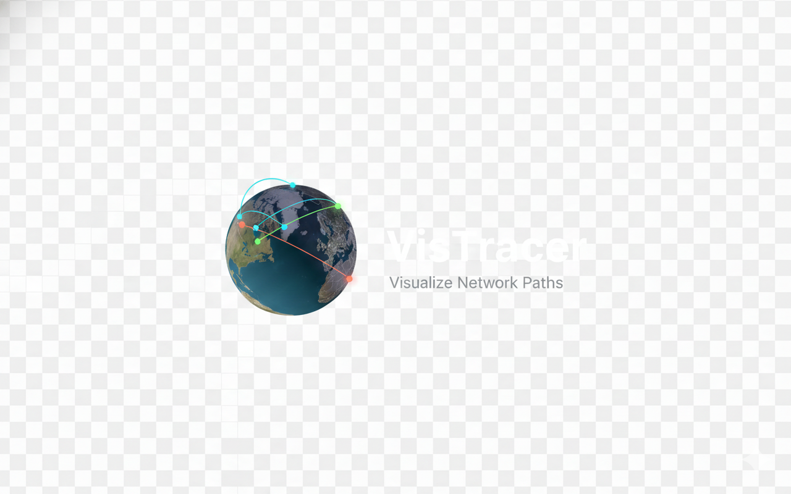
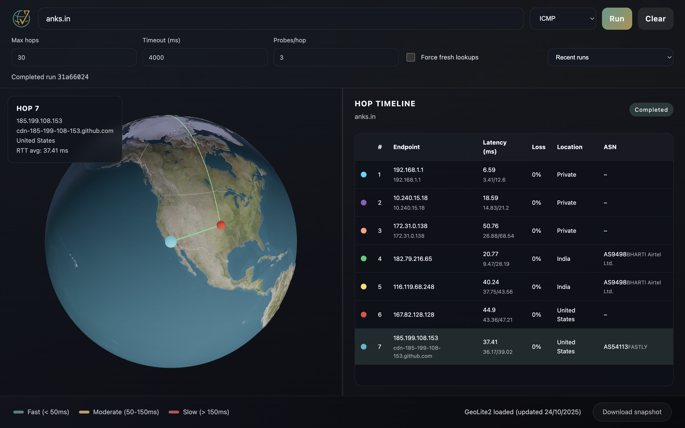
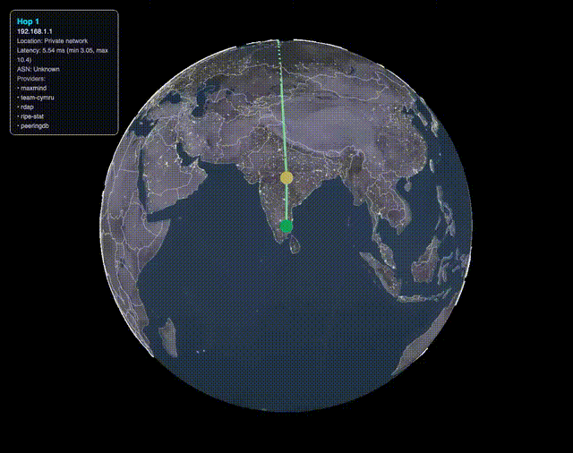

<div align="center">
  

  # VisTracer

  [](https://github.com/rush-skills/vistracer/actions/workflows/ci.yml)
  [](./LICENSE)
  [](https://github.com/rush-skills/vistracer/releases/latest)

  **[vistracer.anks.in](https://vistracer.anks.in)**

  Visual traceroute desktop application built with Tauri v2 and React. VisTracer executes traceroute locally, enriches hops with GeoIP, ASN, and external registry metadata, and animates hop-to-hop routes on a 3D globe alongside an interactive hop timeline.

  
</div>

## Download

Pre-built binaries are available on the [Releases](https://github.com/rush-skills/vistracer/releases/latest) page:

| Platform | Format |
|----------|--------|
| macOS    | `.dmg`: one universal DMG for Apple Silicon and Intel (releases after v1.0.0; v1.0.0 is Apple Silicon only) |
| Windows  | `.exe` (NSIS installer) |
| Linux    | `.AppImage`, `.deb` |

Releases after v1.0.0 update themselves: VisTracer checks the latest GitHub release on start and offers **Install and restart**. Downloads are signature-checked before they are installed.

## Why a Desktop App?

VisTracer is built as a native desktop application (Tauri v2 + Rust) rather than a web app because **traceroute requires native system access**. Web browsers cannot execute system commands like `traceroute` or `tracert` for security reasons. As a Tauri app, VisTracer can:

- Spawn native traceroute/tracert processes directly on your local machine
- Access system binaries with proper permissions (ICMP requires elevated privileges)
- Read and parse real-time output from the traceroute process
- Provide a true "from your network" perspective for diagnosing connectivity issues

This architecture ensures you get authentic network diagnostics from your actual location and ISP, rather than relying on remote servers or limited browser APIs.

## Core Capabilities

- Cross-platform Tauri v2 shell with Rust backend and type-safe IPC to the React frontend.
- Native traceroute execution (ICMP/UDP/TCP) via system binaries with cancellation support.
- Streaming progress updates: each hop appears as soon as its line is parsed; DNS, GeoIP and registry lookups fill it in afterwards, so a slow lookup never holds up later hops.
- Load-balanced (multipath) hops: every responder of a hop is shown with its own RTTs.
- GeoIP/ASN enrichment via local MaxMind GeoLite2 databases.
- Enrichment through Team Cymru, RDAP, RIPEstat and PeeringDB, with retry/backoff, per-provider rate limits and a 7-day cache. A failed provider never hides the GeoLite2 data.
- Hop locations from several sources (PeeringDB exchange LANs, router host names, GeoLite2), checked against the speed of light, with an honest confidence and radius per hop. Anycast addresses are marked and not drawn at a fake point.
- 3D globe (CesiumJS) with NASA Blue Marble and Black Marble imagery bundled for offline use, raised great-circle arcs coloured by latency bands, per-hop markers and an uncertainty ring true to scale. The globe fills the window; the controls float over it on translucent panels, in a dark or a light theme.
- Hop timeline with each hop's RTT (average, min-max, every probe), loss and location confidence; latency jumps (such as an ocean cable) are marked. Selection and hover stay in step between the globe, the timeline and the hop table, and hovering a hop shows a compact card.
- Layer panel: show or hide route arcs, hop markers, confidence rings, anycast reach, labels, day/night shading and online imagery.
- Command bar (⌘K on macOS, Ctrl+K on Windows and Linux) for everything the app does, from the keyboard.
- Battery-friendly rendering: the globe draws only when something changes, and stops completely when idle, hidden or minimized.
- Detailed hop table with RTT stats, packet loss, location and ASN metadata (including PeeringDB facility context when available).
- Snapshot and animation exports saved directly to your downloads folder (PNG/JPG/WebP for stills, WebM/GIF for animated routes).

## Getting Started

### Prerequisites

- Node.js 22+ (LTS recommended)
- npm 9+
- Access to the system `traceroute` (macOS/Linux) or `tracert` (Windows) binary.
- **GeoLite2 databases** (optional, but recommended - see below)

### GeoLite2 Databases (Optional)

VisTracer can provide rich geographic visualization and network details when MaxMind GeoLite2 databases are available. The application **will work without them**, but it falls back to public registries, so location and ASN accuracy may drift.

**Quick Setup:**
1. Create a free MaxMind account at https://www.maxmind.com/en/geolite2/signup
2. Download `GeoLite2-City.mmdb` and `GeoLite2-ASN.mmdb`
3. Launch VisTracer, open the settings (gear in the toolbar, top right), and browse to the downloaded files under **GeoIP databases**

**For detailed setup instructions**, including custom paths and troubleshooting, see [GEOLITE2_SETUP.md](./GEOLITE2_SETUP.md).

If databases are missing, a warning banner appears in the status bar (bottom left). The same settings can be opened from the banner or the gear icon; no restart is needed.

### External Enrichment Providers

In addition to GeoLite2, VisTracer looks up each public hop address in these registry services:

| Provider | Gives | Credentials | Default |
| --- | --- | --- | --- |
| **Team Cymru** | Origin ASN, BGP prefix, registry, AS name (whois over TCP port 43) | none | on |
| **RDAP** (default `https://rdap.org/ip`) | Network name, registrant org, CIDR, country | optional custom base URL | on |
| **RIPEstat** | Announced prefix and origin ASNs from live BGP data | identifies as `VisTracer` | on |
| **PeeringDB** | Network type, peering policy, IXP and facility counts per ASN | optional API key (higher rate limit) | off |
| **Internet exchanges** | PeeringDB's public exchange list, used to place hops at an exchange. Nothing about your route is sent. | none (uses the PeeringDB key if one is saved) | on |

- Turn each provider on or off in **Integration settings** (gear icon) or with the lookup switches in the trace options (the sliders button next to **Trace**). The settings also hold the RDAP base URL and the PeeringDB API key.
- Only public hop addresses are sent. Private, CGNAT, link-local and documentation addresses never leave your machine.
- Answers are cached for 7 days in the app cache folder. **Force fresh lookups** skips the cache for one run.
- Calls retry with backoff on rate limits, server errors and timeouts. If a provider still fails, the hop shows "N sources failed" and the hop details list each provider with its result.
- The hop details panel shows every responder, the merged ASN/prefix/registry data, and the PeeringDB record (or why there is none).

See [docs/architecture.md](./docs/architecture.md) for the pipeline and the merge rules.

### Hop locations

GeoLite2 often puts a router at its operator's head office or in the middle of a country. VisTracer collects every location candidate for a hop and picks the best one:

| Source | Example | Typical radius |
| --- | --- | --- |
| **Exchange (IX) peering LAN** (PeeringDB) | `80.81.192.96` is on the DE-CIX Frankfurt LAN | 25–150 km |
| **Router host name** | `be2816.ccr42.ham01.atlas.cogentco.com` names Hamburg | 50 km |
| **GeoLite2 city / country** | "Bengaluru, India" or "United States" | 20–1000 km |

- **Speed of light.** Light in fibre covers about 200 km per millisecond one way, so a hop's round-trip time limits how far it can be from you. Each location is checked against the estimate of a reference hop (the first public hop with a city-level location, often from GeoLite2). A location that is impossible relative to that estimate and weaker than it is not drawn. One that is at least as strong is kept and marked as a conflict, because the reference can be wrong too. A location that fits gets a tighter or wider radius. Locations are never moved by RTT alone.
- **Anycast.** Public DNS resolvers, the DNS root servers and some CDN networks answer from the nearest of many sites. These hops show an "anycast" tag and a notice, and get no point on the globe.
- **Confidence.** Each drawn hop has a ring on the globe with its radius in km: solid for high confidence, dashed and fainter for medium and low. The hop details show the source, confidence, radius, the RTT check, the IXP or host name that matched, and the other candidates.
- Exchange matching has its own switch (**Internet exchanges**, on by default), separate from PeeringDB. It downloads PeeringDB's public exchange list at most once a day and sends nothing about your route.

Data sources and licenses: [src-tauri/data/README.md](./src-tauri/data/README.md) (OurAirports, public domain) and [docs/third-party-data.md](./docs/third-party-data.md). Rules and known limits: [docs/architecture.md#hop-locations](./docs/architecture.md#hop-locations).

### Linux: ICMP and TCP need raw sockets

`traceroute -I` (ICMP) and `-T` (TCP) need raw-socket privileges on Linux. Without them, VisTracer runs the trace again with UDP probes and shows a notice. To allow ICMP/TCP without running the app as root, give the system binary the capability once:

```bash
sudo setcap cap_net_raw+ep "$(readlink -f "$(command -v traceroute)")"
```

On macOS, TCP traces ask for your administrator password; VisTracer only runs `/usr/sbin`, `/usr/bin`, `/sbin` or `/bin` binaries that root owns with elevated rights.

### Install Dependencies

```bash
npm install
```

### Development Workflow

Run the Tauri + Vite development environment:

```bash
npm run tauri:dev
```

The command starts the Vite dev server for the frontend and compiles/launches the Rust backend.
Frontend changes benefit from hot-reload; Rust changes trigger an automatic recompile.

### Production Build

```bash
npm run build
```

### Desktop Packages

Tauri bundles native installers for each platform:

```bash
npm run tauri:build   # builds frontend + Rust backend and produces platform installer
```

Build artifacts are placed in `src-tauri/target/release/bundle/`.

> **Cross-building tip:** Creating Windows installers from macOS/Linux (or vice versa) requires the platform-specific toolchain (`xcode-select --install` on macOS, `wine`/`mono` for Windows targets, `fpm` for Debian packages). For the most reliable output, run the matching command on that operating system or inside a CI runner/VM that provides the necessary dependencies.

### Linting & Tests

```bash
npm run lint        # ESLint across renderer and shared sources
npm run typecheck   # TypeScript type check
npm run test        # Vitest unit and component tests
npm run test:e2e    # Vitest bridge/store integration tests
cd src-tauri && cargo test                               # Rust tests
cd src-tauri && cargo clippy --all-targets -- -D warnings
```

## Project Structure

```
src/
  renderer/    React application (modules, state store, CesiumJS globe, hooks)
    public/    Files loaded by URL: bundled globe imagery, country borders
  common/      Shared TypeScript contracts (bridge, IPC types, net utils)
src-tauri/
  src/         Rust backend (commands, persistence, traceroute, geo, DNS)
assets/        Logo, app icons and README media (not shipped in the app, except the logo)
```

## GeoLite2 Database Management

Open the settings from the gear icon in the toolbar (or the status bar banner, if shown) to review the current GeoLite2 status and edit paths. The modal displays the last update time along with success/error badges for each file.

- **Configure databases**: Browse to new `.mmdb` files at any time; VisTracer will reload them immediately.
- **Update databases**: Download newer versions from MaxMind and point the modal to the new paths or replace the files in place.
- **No restart required**: Changes take effect as soon as you save.

For detailed instructions on downloading, installing, and updating databases, see [GEOLITE2_SETUP.md](./GEOLITE2_SETUP.md).

**Note**: The application works without databases but provides limited information (no geographic coordinates, city names, or ASN details).

## Using the app

- **Layout.** The trace panel is top left: type a host name or IP address and press **Trace**. The sliders button opens the trace options (max hops, timeout, probes, force fresh lookups, recent runs, lookup switches). The hop table and the selected hop's details are on the right, the hop timeline and the status bar at the bottom. Each panel can collapse, and VisTracer remembers which ones you collapsed, your theme and your layer switches.
- **Hops.** Click a hop on the globe, in the timeline or in the table to select it everywhere; the globe flies to it. Hover a hop on the globe or in the timeline for a card with its host name, address, network, location (with source and confidence), RTT and loss. The card only shows data the app already has; hovering sends nothing anywhere.
- **Timeline.** One column per hop: the bar is the average RTT, the line the min-max range, the ticks the single probes. An amber "+81" marks a rise of 20 ms or more over the previous hop that answered: usually a long link such as an ocean cable, sometimes a router that answers slowly. The three small bars show how sure the location is.
- **Layers.** The layers button in the toolbar opens switches for route arcs, hop markers, confidence rings, anycast reach, labels, day/night shading and **Online imagery**. With online imagery off, VisTracer downloads no NASA GIBS tile at all and uses only the bundled imagery; the backend refuses those downloads too.
- **Theme.** The sun/moon button switches between the dark (default) and the light theme. With "reduce motion" or "reduce transparency" set in your system, animations stop and the panels become solid.
- **Credits.** The small "NASA, GIBS, CesiumJS" button in the lower right corner lists every data source and its license.

### Keyboard shortcuts

| Keys | Does |
| --- | --- |
| ⌘K (macOS), Ctrl+K (Windows, Linux) | Open or close the command bar: search any command, go to a hop, show or hide a layer, switch theme, export, clear the tile cache, or type a host name to trace it |
| ↑ ↓, Enter, Esc | In the command bar: move, run, close |
| ← → (or ↑ ↓), Home, End | In the hop timeline: select the previous, next, first or last hop |
| Enter, Space | In the hop table: select the hop |
| Esc | Close the command bar, the layer panel, the credits or a dialog; hide the hover card of a hop focused in the timeline |

## Globe imagery and day/night

- **Offline first.** NASA Blue Marble (day) and Black Marble 2016 (night lights) ship with the app at five zoom levels (6.5 MB, about 5 km per pixel at the closest). The globe looks right with no network.
- **Detail when you zoom in.** Closer than that, VisTracer loads Blue Marble tiles (down to about 600 m per pixel) from NASA GIBS (`gibs.earthdata.nasa.gov`, no account or key). The backend fetches them and keeps them in a 500 MB cache in the app cache folder; **Integration settings → Globe imagery** shows its size and clears it. Offline, the globe magnifies the bundled tiles and says that detailed imagery is unavailable. These downloads show NASA the approximate areas you zoom into. Automatic camera moves (following a trace, selecting a hop, exports) stay zoomed out far enough that they use only the bundled imagery. Online tiles stay off at start-up and after such moves until you zoom, drag or tilt the globe yourself, so only your own camera moves download tiles. Switch **Online imagery** off in the layer panel to download none at all.
- **Day and night.** The sun is placed from the current time (CesiumJS solar model). Far out, the dark side shows city lights; zoomed in, the globe is fully lit so you can see the ground under a hop.
- **Battery.** The globe renders a frame only when the view or the data changes, runs no animation loop at all when idle, pauses while the window is hidden or minimized, and caps the frame rate at 60 (30 on battery where the webview reports it). The terminator moves every 10 minutes while idle.

Data sources and licenses: [docs/third-party-data.md](./docs/third-party-data.md).

## Snapshot & Media Export

- Click **Export route** in the status bar to capture the current globe, or use the command bar (**Export a PNG snapshot**, **Export a WebM animation**, **Export a GIF animation**; animations show each hop for 2 s).
- Still images support PNG, JPG, and WebP. Animated exports support WebM (hardware-accelerated via `MediaRecorder`) and GIF (bundled encoder).
- Configure the dwell time per hop for animated formats; the tooltip stays on-screen with ASN, PeeringDB, and location details for each hop.
- Files are saved to your system's default download location (typically `~/Downloads` on macOS/Linux or `C:\Users\<username>\Downloads` on Windows).
- Filenames follow the pattern `vistracer-snapshot-YYYY-MM-DDTHH-MM-SS.ext` for stills and `vistracer-route-YYYY-MM-DDTHH-MM-SS.ext` for animations.
- The export button is available once a traceroute run has completed, and MP4 export is intentionally not supported (WebM/GIF cover animation needs without extra codecs).



## Known Gaps & Next Steps

- Scheduled GeoLite2 refresh (auto-download via license key works; periodic refresh is not yet automated)
- MP4 export remains out of scope; use WebM or GIF instead.
- A view that compares two traces is planned but not implemented in this build
- Windows `tracert` only sends ICMP probes, three per hop; the UDP/TCP choice does not apply there
- Only the first responder of a multipath hop is geolocated and sent to the registry providers; the others show their address, host name and RTTs

## Contributing

See [CONTRIBUTING.md](./CONTRIBUTING.md) for development setup, coding standards, and PR workflow.

## Additional Documentation

- [GEOLITE2_SETUP.md](./GEOLITE2_SETUP.md) - Complete guide to downloading and configuring GeoLite2 databases
- [docs/architecture.md](./docs/architecture.md) - Hop pipeline, enrichment, globe, tile cache, storage and security
- [docs/third-party-data.md](./docs/third-party-data.md) - Bundled code and data, imagery sources and licenses
- [docs/releasing.md](./docs/releasing.md) - Update signing key setup and the release workflow
- [CLAUDE.md](./CLAUDE.md) - Architecture overview and development guide for contributors
- [CHANGELOG.md](./CHANGELOG.md) - Release history
