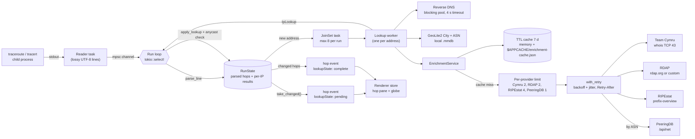

# VisTracer architecture

VisTracer is a Tauri v2 app. The Rust backend (`src-tauri/`) runs the
traceroute binary and looks up each hop. The React renderer (`src/renderer/`)
draws the route on a globe and lists the hops. They talk over Tauri IPC
(`src/common/bridge.ts`, `src/common/ipc.ts`).

## Hop pipeline

The read loop never waits for a lookup. It parses each output line, emits the
hop at once, and hands new addresses to lookup tasks. Each finished lookup
emits an update for the hops that use that address.

### Steps

1. **Plan the command** (`commands/traceroute_command.rs`). `SystemLocator`
   finds the binary through `PATH`, then `/usr/sbin`, `/usr/bin`, `/sbin`,
   `/bin`, `/usr/local/*` (or `%SystemRoot%\System32` on Windows). A missing
   binary gives an install command. Targets that start with `-` or contain
   other characters than letters, digits, `.`, `-`, `:`, `_`, `%` are rejected.
2. **Spawn and read** (`commands/traceroute.rs`). A reader task forwards
   stdout lines. macOS TCP traces need root, so they run through the
   `osascript` administrator prompt, write to a temp file, and the reader
   follows that file. The elevated binary must be a root-owned file in a
   root-only system directory; `PATH` is not used for it.
3. **Parse** (`commands/traceroute_parse.rs`). Every responder on a line is
   kept: Linux prints load-balanced responders on one line, macOS prints them
   on indented lines without a hop number, Windows puts the RTT columns before
   the address. Regexes compile once (`LazyLock`).
4. **Render hops** (`commands/run_state.rs`). `RunState` keeps the parsed
   lines and the per-address results. Every `HopResolution` is rendered from
   that state, so lines and lookups can arrive in any order. Only hops whose
   value changed are emitted.
5. **Look up** (`commands/lookup.rs`). The first responder of a hop gets a
   full lookup (reverse DNS, GeoLite2, providers). Other responders of a
   multipath hop only get reverse DNS. An address that later becomes a primary
   responder is upgraded to a full lookup.
6. **Finish**. After the process exits and the lookups finish, the backend
   emits the completed run and writes the provider cache to disk. Cancel
   kills the process and aborts the lookups in flight.

### Linux privileges

ICMP (`-I`) and TCP (`-T`) probes need raw sockets on Linux. When such a run
fails with a permission error before the first hop line, VisTracer runs the
trace again with UDP probes and adds a notice to the run. The notice shows a
`setcap cap_net_raw+ep` command only when the binary is a root-owned system
binary. For TCP, `tcptraceroute` is used for IPv4 when it is installed;
otherwise `traceroute -T`.

## Enrichment

`commands/integrations.rs` holds one parser per provider (tested against real
responses in `src-tauri/fixtures/providers/`) and the merge.

| Provider | Key | Gives | Default |
| --- | --- | --- | --- |
| GeoLite2 (local) | IP | coordinates, city, country, ASN, AS org | on when databases are configured |
| Team Cymru | IP | origin ASN, BGP prefix, country, registry, AS name | on |
| RDAP | IP | network name and handle, registrant org, CIDR, country, registry | on |
| RIPEstat | IP | announced prefix, origin ASNs and holders | on |
| PeeringDB | ASN | network type, scope, peering policy, IXP and facility counts | off |

Rules:

- Private, CGNAT (100.64/10), link-local, loopback, multicast and
  documentation addresses are never sent to a provider.
- Each provider call goes through the cache, then the provider's concurrency
  limit, then the cache again (another hop may have filled it), then
  `with_retry`. Retries happen on HTTP 429, 5xx, timeouts and connection
  errors: 3 attempts, exponential backoff from 500 ms to 8 s with jitter, and
  a server `Retry-After` is honoured. One provider lookup has a 25 s budget.
- "No record" answers are cached too, so repeated misses do not hit the
  network. Errors are not cached. "Force fresh lookups" skips cache reads.
- A failed provider reports `status: "error"` with a message. The hop keeps
  the GeoLite2 data and the data of the other providers. The hop pane shows
  "N sources failed" and the message for each.
- Merge (`merge_asn`): the ASN comes from Team Cymru, then RIPEstat, then
  GeoLite2 (live BGP before the database snapshot). The name only comes from
  a source that agrees on that ASN, then PeeringDB, then the RDAP registrant.
  The prefix comes from RIPEstat (when announced), then Team Cymru, then RDAP.

### Anycast

No provider flags anycast prefixes. `commands/anycast.rs` uses a
speed-of-light check instead: light in fibre covers about 100 km per
millisecond of round-trip time. When GeoLite2 places a hop further from the
vantage point (the first public hop with a location) than its minimum RTT
allows, plus the accuracy radii and 100 km slack, the hop is marked
`isAnycastSuspected`. The UI calls it "suspected": the cause can also be a
wrong geolocation.

## Settings and storage

| What | Where |
| --- | --- |
| Settings (GeoIP paths, preferences, integrations, PeeringDB key) | `$APPDATA/settings.json` |
| GeoLite2 downloads | `$APPDATA/databases/` |
| Provider cache | `$APPCACHE/enrichment-cache.json` |
| Reverse DNS cache, recent runs | memory only |

Integration settings are validated in `set_settings` (`IntegrationSettings::validated`):
the RDAP base URL must be `http(s)`, the PeeringDB key must not contain spaces.

## Security

- **CSP** (`tauri.conf.json` → `app.security.csp`): scripts, styles, images and
  fonts from the app only, `connect-src` for the Tauri IPC, `blob:` workers for
  the GIF encoder. The renderer does not call any remote host; providers run in
  Rust. `devCsp` adds `'unsafe-inline'` and the Vite dev server for HMR.
- **Capabilities** (`capabilities/default.json`): file system access only under
  `$APPDATA`, `$APPCACHE` and `$DOWNLOAD` (read, write, exists, mkdir; no
  remove or rename). Paths picked in a dialog are added at run time by the
  dialog plugin. `updater:default` and `process:allow-restart` for updates.

## Updates

The updater plugin reads `latest.json` from the newest GitHub release. The app
checks 5 s after start and from **Integration settings → Updates**. While
`plugins.updater.pubkey` is the placeholder, `get_app_info` reports
`updaterConfigured: false` and the app does not contact the update server.
The plugin verifies the download signature before it installs. See
[releasing.md](./releasing.md) for the signing setup and the release workflow.
