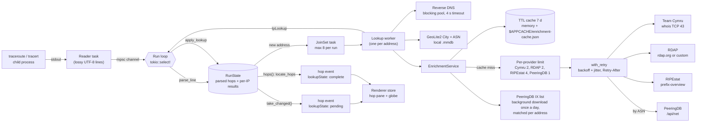
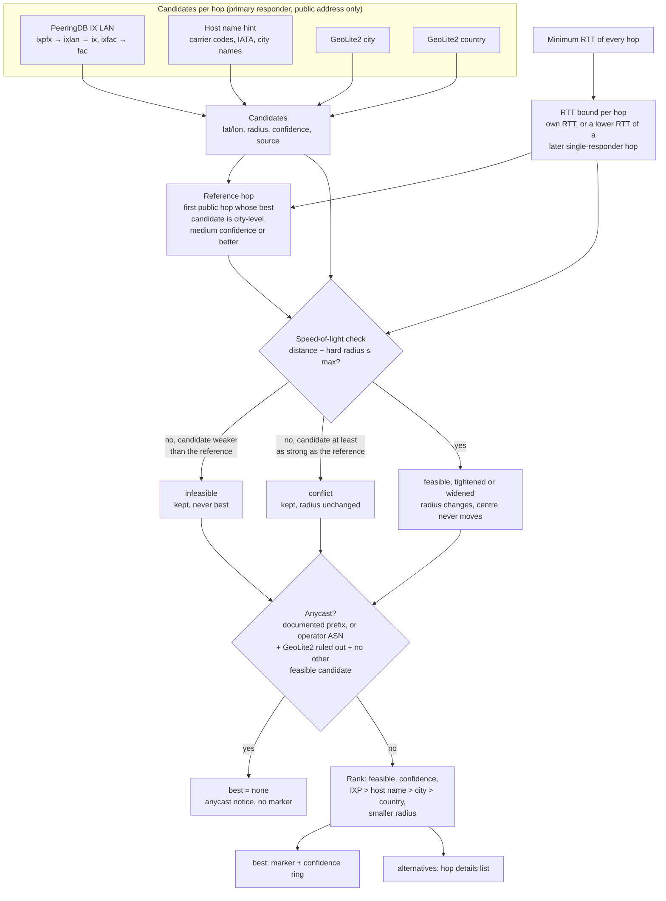

# VisTracer architecture

VisTracer is a Tauri v2 app. The Rust backend (`src-tauri/`) runs the
traceroute binary and looks up each hop. The React renderer (`src/renderer/`)
draws the route on a globe and lists the hops. They talk over Tauri IPC
(`src/common/bridge.ts`, `src/common/ipc.ts`).

## Hop pipeline

The read loop never waits for a lookup. It parses each output line, emits the
hop at once, and hands new addresses to lookup tasks. Each finished lookup
emits an update for the hops that use that address.

### Steps

1. **Plan the command** (`commands/traceroute_command.rs`). `SystemLocator`
   finds the binary through `PATH`, then `/usr/sbin`, `/usr/bin`, `/sbin`,
   `/bin`, `/usr/local/*` (or `%SystemRoot%\System32` on Windows). A missing
   binary gives an install command. Targets that start with `-` or contain
   other characters than letters, digits, `.`, `-`, `:`, `_`, `%` are rejected.
2. **Spawn and read** (`commands/traceroute.rs`). A reader task forwards
   stdout lines. macOS TCP traces need root, so they run through the
   `osascript` administrator prompt and write to a temp file that the reader
   follows. The elevated binary must be a root-owned file in a root-only
   system directory; `PATH` is not used for it. The root shell creates the
   output file itself (`set -C`, one redirection), so a symlink planted in
   the temp folder cannot make root overwrite another file. On Windows,
   `tracert` starts without a console window.
3. **Parse** (`commands/traceroute_parse.rs`). Every responder on a line is
   kept: Linux prints load-balanced responders on one line, macOS prints them
   on indented lines without a hop number, Windows puts the RTT columns before
   the address. Regexes compile once (`LazyLock`).
4. **Render hops** (`commands/run_state.rs`). `RunState` keeps the parsed
   lines and the per-address results. Every `HopResolution` is rendered from
   that state, so lines and lookups can arrive in any order. Only hops whose
   value changed are emitted.
5. **Look up** (`commands/lookup.rs`). The first responder of a hop gets a
   full lookup (reverse DNS, GeoLite2, providers). Other responders of a
   multipath hop only get reverse DNS. An address that later becomes a primary
   responder is upgraded to a full lookup.
6. **Locate** (`geoloc/estimate.rs`). Every time hops are rendered, the
   location of each hop is estimated across the whole run (see
   [Hop locations](#hop-locations)). A new hop can change earlier hops (a
   lower RTT tightens their bound); such hops are emitted again.
7. **Finish**. After the process exits and the lookups finish, the backend
   emits the completed run and writes the provider cache to disk. Cancel
   kills the process and aborts the lookups in flight, also when the process
   has already exited and only lookups are left. Exception: a macOS TCP run
   is started as root through `osascript`. Cancel kills `osascript`, but the
   root `traceroute` keeps running until it ends (stopping it needs root);
   its output is ignored.

### Linux privileges

ICMP (`-I`) and TCP (`-T`) probes need raw sockets on Linux. When such a run
fails with a permission error before the first hop line, VisTracer runs the
trace again with UDP probes and adds a notice to the run. The notice shows a
`setcap cap_net_raw+ep` command only when the binary is a root-owned system
binary. For TCP, `tcptraceroute` is used for IPv4 when it is installed;
otherwise `traceroute -T`.

## Enrichment

`commands/integrations.rs` holds one parser per provider (tested against real
responses in `src-tauri/fixtures/providers/`) and the merge.

| Provider | Key | Gives | Default |
| --- | --- | --- | --- |
| GeoLite2 (local) | IP | coordinates, city, country, ASN, AS org | on when databases are configured |
| Team Cymru | IP | origin ASN, BGP prefix, country, registry, AS name | on |
| RDAP | IP | network name and handle, registrant org, CIDR, country, registry | on |
| RIPEstat | IP | announced prefix, origin ASNs and holders | on |
| PeeringDB | ASN | network type, scope, peering policy, IXP and facility counts | off |
| PeeringDB IX list | IP (local match; only the public list is downloaded) | IX peering LAN that contains the address, IX position | on (own switch, `ixMatching`) |

Rules:

- Private, CGNAT (100.64/10), link-local, loopback, multicast,
  documentation, benchmarking/"fake IP" (198.18/15), reserved (240/4) and
  IPv4-mapped private addresses are never sent to a provider.
- An empty Team Cymru reply is a retryable error and is not cached.
- Each provider call goes through the cache, then the provider's concurrency
  limit, then the cache again (another hop may have filled it), then
  `with_retry`. Retries happen on HTTP 429, 5xx, timeouts and connection
  errors: 3 attempts, exponential backoff from 500 ms to 8 s with jitter, and
  a server `Retry-After` is honoured. The request, retries included, has a
  25 s budget.
- A lookup waits at most 25 s for a free provider slot. If none frees up, the
  provider is marked `skipped` ("Not queried: …"). This wait does not count
  as a provider failure.
- After 3 failed requests in a row, a provider is skipped for 60 s (its
  status says so). A provider that is down therefore costs a few timeouts per
  run instead of one timeout per hop.
- "No record" answers are cached too, so repeated misses do not hit the
  network. Errors are not cached. "Force fresh lookups" skips cache reads.
  RDAP answers are cached per base URL, so switching RDAP servers takes
  effect at once.
- A failed provider reports `status: "error"` with a message. The hop keeps
  the GeoLite2 data and the data of the other providers. The hop pane shows
  "N sources failed" and the message for each.
- Merge (`merge_asn`): the ASN comes from Team Cymru, then RIPEstat, then
  GeoLite2 (live BGP before the database snapshot). The name only comes from
  a source that agrees on that ASN, then PeeringDB, then the RDAP registrant.
  The prefix comes from RIPEstat (when announced), then Team Cymru, then RDAP.

## Hop locations

GeoLite2 often places a router at its operator's registered address or at a
country centroid. `geoloc/` collects every location candidate for a hop,
removes the ones that the speed of light rules out, and ranks the rest. The
hop carries all of them in `HopLocation`: `best` (drawn on the globe),
`alternatives` (listed in the hop details), the IXP match, the host name
hint and an anycast notice.

### Candidates

| Source | Centre | Radius | Confidence |
| --- | --- | --- | --- |
| PeeringDB IX LAN (`geoloc/ixp.rs`) | centre of the IX facilities; the IX city when no facility has coordinates | distance to the furthest facility, at least 25 km (city fallback 50 km) | high up to 150 km, medium up to 500 km, low beyond |
| Host name hint (`geoloc/hostname.rs`) | airport of the named city (`data/airports.csv`) | 50 km | high for a known carrier's scheme or a matching country label, medium for generic codes, low for a bare 3-letter code |
| GeoLite2 city | record coordinates | `accuracy_radius` (200 km when missing) | medium up to 100 km, low beyond |
| GeoLite2 country | country centroid | `accuracy_radius` (1000 km when missing) | low |

Host name rules:

- A token counts only as a whole label or a whole `-` piece of a label,
  with at most a site number after it (`fra03`, `Frankfurt1`, `lsanca07`).
  The registered domain (`cogentco.com`, `prod-infinitum.com.mx`) is not
  read.
- Router role and interface tokens that are also airport codes (`ccr`
  Concord, `mag` Madang, `ibr` Ibaraki, `pos` Port of Spain) are never read
  as places. Other host name words that are also airport codes (`cgn`
  Cologne, `man` Manchester, `sat` San Antonio) are only read in a known
  carrier's site label.
- Known carrier domains (NTT, Cogent, Arelion, Hurricane Electric, Lumen,
  Tata, Zayo, GTT, Google, Microsoft, Verizon, Comcast) raise the scheme
  that carrier uses to high confidence and add carrier site codes (Arelion
  `ffm`, HE `fmt`). Where the site label has a fixed position (Cogent
  `man01.atlas`, Microsoft `par21.ntwk`), only that label is read.
- A bare 3-letter code, or the code of a small (medium) airport outside a
  known carrier's names, needs another source to agree on the country.
  Example: Tele2's `avk1` is a site name, not Arvaikheer in Mongolia.
- A 2-letter label right after the token (`lsanca07.us`, `lhr15.uk`,
  `ashburn.va`) must agree with the place's country or US state; if it names
  another country, the hint is dropped.
- Two different places at the same confidence cancel out.

The fixture list `src-tauri/fixtures/hostnames/hints.txt` holds the
positive and negative cases, including host names from real traces.

### RTT check

Light in fibre covers about 200 km per millisecond one way, so a reply after
`rtt` ms comes from at most `rtt / 2 × 200` km away (`reach`). Every probe
starts at the user's machine, so for the reference hop `r` and a hop `h`:

`max = reach(rtt_r) + reach(rtt_h) + hard radius of r + 100 km slack`

A candidate fails the check when `distance(r, candidate) − hard radius >
max`. GeoLite2's `accuracy_radius` is a 67 % radius for end users, not
routers, so the hard radius of a GeoLite2 candidate is twice its radius as a
margin; that is a heuristic, not a guarantee. For IX and host name
candidates the hard radius is the radius itself.

**The reference cannot veto stronger evidence.** The reference location is
itself an estimate, usually GeoLite2, and GeoLite2 often has a router's
registered address. So a candidate that fails the check is only
**infeasible** (kept, never best) when its confidence is lower than the
reference's. A candidate that is at least as strong as the reference gets
the **conflict** verdict: it stays in the ranking with its radius and
confidence unchanged, and the hop details say that it conflicts with the
reference and that one of the two is wrong. Example: hop 2's GeoLite2 record
says Mumbai (medium), a Tata router 5 ms away is named `dl1-delhi` (high).
The Delhi hint fails the check (1,139 km, 840 km allowed) but stays best,
and the hop stays on the globe. A GeoLite2 country centroid (low), such as
8.8.8.8 at the US centroid, is still ruled out.

What the check removes therefore depends on the reference. The usual
reference is the first hop's GeoLite2 city record (medium). Against it, only
low-confidence candidates are ruled out: GeoLite2 country centroids and
GeoLite2 city records with a radius above 100 km. A GeoLite2 city record of
another hop with a radius up to 100 km is also medium, so it is kept as a
conflict even when it is a registered address far from the path. A conflict
ring on the globe uses the low-confidence style, and the hop table shows a
"conflict" tag.

A feasible candidate is **tightened** when the whole area within `max` of
the reference lies inside its radius (the radius shrinks to
`distance + max`), and **widened** when that area starts beyond its radius
(the radius grows, at most to the hard radius). A widened candidate drops
to low confidence only when it is weaker than the reference; otherwise it
would lose the ranking to a weaker record, which is what the conflict rule
prevents. The check never moves a candidate.

- **Reference hop.** The app does not know the user's own address, so the
  reference is the first public hop whose best candidate has a radius of at
  most 200 km and at least medium confidence. Its RTT puts the user within
  `reach(rtt_r)` of it, which is part of `max`. The hop details say which
  hop is the reference. Its other candidates are not checked.
- **Primary responder.** A hop's candidates describe its first responder,
  so the bound uses that responder's RTTs, not a faster path of a
  load-balanced hop.
- **Later hops.** A router on the path is no further away than any hop
  reached through it, so a hop's bound is the lowest RTT of itself and the
  later hops. This helps routers that answer slowly (ICMP generated in
  software). It is used only when the hop and the later hop each have one
  responder, because a load-balanced path may not pass the router.

### Anycast

No registry provider flags anycast, so `geoloc/anycast.rs` uses two
bundled lists:

- **Documented anycast prefixes**: public DNS resolvers (Cloudflare, Google,
  Quad9, OpenDNS) and the 13 DNS root servers. An address in one of them is
  anycast whatever the RTT says.
- **Anycast operators**: ASNs that announce their address space from many
  sites (Cloudflare, Fastly, Quad9, OpenDNS, PCH). These networks also have
  unicast router addresses, so the hop counts as anycast only when the RTT
  rules out its GeoLite2 location and no IX or host name candidate is
  feasible. A feasible IX or host name candidate means a unicast router.

An anycast hop has no best estimate: no marker, no ring and no arc. The hop
details say why and give the RTT bound ("the site that answered is at most
740 km from hop 2"). Example: 8.8.8.8 answers in 4 ms from Mumbai, while
GeoLite2 places it at the US centroid about 13,000 km away.

### PeeringDB IX list

Exchange matching has its own switch (`integrations.ixMatching`, "Internet
exchanges" in the settings), on by default and separate from the PeeringDB
switch, which only controls the per-ASN lookups that send hop data. Settings
files saved before the switch existed load with it on. When it is on,
`commands/ix_list.rs` downloads five lists (`ixpfx`, `ixlan`, `ix`, `ixfac`,
`fac`, with `fields=` to keep them small) one at a time, with the saved
PeeringDB API key when there is one, the PeeringDB slot, retries, and 2 s
between requests as PeeringDB asks. The download sends nothing about the
user's route; matching happens on the user's machine. The joined dataset
(on 2026-10-24: 1,332 exchanges and 2,658 prefixes, about 340 KB of JSON)
is kept in the provider cache for 24 h and written to disk as soon as the
download ends.

- The download runs in its own task. A lookup never waits for a refresh: a
  list up to 7 days old is used at once, and the provider status says that
  a newer one is downloading. Only when there is no list at all does a
  lookup wait for the download, for at most 25 s; after that the IX source
  is "skipped" for that hop, not "failed".
- A cancelled run does not stop the download, so the lists already fetched
  are not thrown away.

- PeeringDB allows one identical anonymous request above 100 kB per hour.
  "Force fresh lookups" therefore does not download the list again, and a
  smoke test that reran within the hour got HTTP 429.
- After a failed download there is no new attempt for 15 min. A list up to
  7 days old is used meanwhile; the provider status says the refresh
  failed.
- An HTTP 429 from PeeringDB is final: no retry within seconds, and no new
  download for `max(1 h, Retry-After)`, at most 24 h, because the limit is
  per hour. The cap keeps one server answer from turning exchange matching
  off for the session. This backoff is kept in memory only: after a restart
  within the hour, the app sends one more request, which gets a 429 again.
- The provider cache keeps entries for at least 7 days, also when the
  provider TTL (`cacheSettings.enrichmentTtlMs`) is shorter, so a short TTL
  cannot make the app download the list more than once a day. The cache
  holds at most 4,000 entries and drops the oldest first; the IX list is one
  entry and at most a day old in normal use.
- IX LAN prefixes shorter than /16 (IPv4) or /32 (IPv6) are treated as data
  errors and ignored.

### Known limits

- A wrong reference location can still rule out correct candidates that
  are weaker than the reference. Example: GeoLite2 places the user's first
  public hop in Mumbai (medium) while the user is in Delhi; a low-confidence
  GeoLite2 record that correctly says Delhi for a hop 3 ms away is ruled
  out. Candidates as strong as the reference are kept as conflicts.
- The reverse also holds: with a medium GeoLite2 reference, a wrong
  medium GeoLite2 record of another hop (a registered address with a radius
  up to 100 km, for example "Ashburn ±20 km" for a router 3 ms from Mumbai)
  is kept as a conflict and drawn. The anycast-operator rule has the same
  limit: it applies only when GeoLite2 is weaker than the reference.
- Remote peering: an address on an IX peering LAN can belong to a router
  far from the exchange (connected over a long-distance link). The IX
  candidate is still high confidence up to 150 km.
- The later-hop bound treats a hop as single-responder after its probes
  (usually 3). Classic UDP traceroute changes the flow per probe, so with
  per-flow load balancing (ECMP) a later hop's probe may not have passed
  this router, and the bound can be too tight.
- RTT gives only an upper bound on distance. A router 150 ms away can be
  anywhere within 15,000 km, so far hops are rarely filtered.
- Host name hints depend on naming schemes that carriers can change. The
  curated tables cover the large carriers only.

## Globe

The globe is CesiumJS, used directly (no wrapper library). React state goes
through pure functions to a scene description; one adapter module draws it
with Cesium primitives. A render governor decides when Cesium draws. Imagery
comes from tiles bundled with the app and, when zoomed in, from NASA GIBS
through a tile cache in Rust.

```mermaid
flowchart LR
    subgraph renderer["Renderer (React)"]
        store[("tracerouteStore<br/>run, selectedHopIndex,<br/>hoveredHopIndex")]
        pane["HopDetailsPane<br/>row hover, click"]
        viewport["GlobeViewport.tsx"]
        mapping["lib/globe.ts (pure)<br/>buildGlobeScene: markers, arcs,<br/>rings, anycast reach, labels<br/>nextCameraFocus, flyHeight"]
        adapter["globe/cesiumGlobe.ts<br/>(only module that imports Cesium)"]
        governor["lib/renderGovernor.ts<br/>wake, idle sleep, fps cap,<br/>hidden or minimized pause"]
        imagery["lib/imagery.ts<br/>layer config, night fade"]
    end
    subgraph cesium["CesiumJS"]
        widget["CesiumWidget<br/>requestRenderMode, own render loop off"]
        prims["PolylineCollection, PointPrimitiveCollection,<br/>LabelCollection"]
        layers["Imagery layers<br/>1 Black Marble (bundled, night)<br/>2 Blue Marble (bundled, day)<br/>3 Blue Marble (online, level 5+)"]
    end
    subgraph rust["Rust backend"]
        scheme["vistiles URI scheme handler"]
        tiles["TileService<br/>parse, allowlist, single flight,<br/>3-failure pause"]
        disk[("TileStore $APPCACHE/tiles<br/>500 MB, LRU")]
        http["HttpFetcher<br/>redirects only to allowed hosts"]
    end
    gibs["NASA GIBS WMTS<br/>gibs.earthdata.nasa.gov"]
    bundled[("./imagery/ tiles<br/>levels 0-4, 6.5 MB")]

    store --> viewport
    pane <-->|hover, select| store
    viewport --> mapping --> adapter
    adapter -->|"pick: hover, click"| store
    adapter --> widget --> prims
    widget --> layers
    governor -->|"tick: resize + render"| widget
    adapter -->|"wake: data, input, resize,<br/>Cesium requestRender"| governor
    imagery --> adapter
    layers -->|levels 0-4| bundled
    layers -->|"level 5+: vistiles://localhost/blue-marble/z/y/x.jpg"| scheme
    scheme --> tiles --> disk
    tiles -->|miss| http --> gibs
```

### Scene mapping

`buildGlobeScene(hops, selected, hovered)` in `src/renderer/lib/globe.ts`
turns hops into plain objects in degrees and metres. The adapter only
converts them to Cesium types. Tests cover the mapping without WebGL.

| Item | Rule |
| --- | --- |
| Marker | One per hop with `location.best`. Size and outline by emphasis: normal, hovered, selected (drawn last, on top). |
| Arc | Great circle between consecutive located hops, raised in the middle (sine profile, peak 12 % of the distance, 2 km to 1,500 km). Colour by the first hop's latency band. Hops less than 1 km apart get no arc. |
| Confidence ring | Circle on the sphere at the estimate's radius in km, segments at most 50 km long. Solid for high confidence, dashed and fainter for medium and low; a `conflict` verdict uses the low style. No ring above 5,000 km. |
| Anycast reach | An anycast hop has no marker, ring or arc. When its RTT bound and reference hop are known, a dotted circle around the reference hop's estimate shows where the answering site can be ("within 740 km of hop 2"). |
| Label | The selected and the hovered hop: "6 · DE-CIX Frankfurt". |
| Country borders | Natural Earth 1:110m, drawn once from `world.geojson`. |

Camera (`nextCameraFocus`): it flies to a newly selected hop, else to the
newest hop that got a location during the run; enrichment updates of the
same hops do not move it. Flights keep the user's zoom unless the hop's ring
would not fit (`flyHeight`). With `prefers-reduced-motion` the camera jumps.

Picking: the arcs end at the markers and are drawn after them, so a pick that
hits an arc looks underneath (`drillPick`, 4 deep) for a marker, ring or
reach. Hovering is checked at most every 50 ms and never while dragging.

### Render governor

Cesium runs with `requestRenderMode`, so it draws a frame only when
something changed. `RenderGovernor` also owns the `requestAnimationFrame`
loop that asks Cesium for those frames:

- The loop runs only after a wake: scene data, pointer down, drag, wheel,
  resize, the 10-minute sun update, or any Cesium `scene.requestRender()`
  (tile loads, worker results). It sleeps after 20 ticks that drew nothing.
  While tiles load, Cesium draws every tick, so the loop stays awake until
  they are in.
- At most 60 ticks per second; 30 on battery where the webview reports it
  (`navigator.getBattery`, Chromium only).
- No ticks while the page is hidden (Page Visibility) or the window is
  minimized (Tauri `onResized` + `isMinimized`, for webviews that do not
  report minimized windows as hidden).
- Costs that add nothing are off: star box, sun and moon, ground atmosphere,
  fog, FXAA, HDR, shadows, order-independent translucency. The canvas uses
  the screen's pixel density up to 2x, and MSAA only below 1.5x.

An idle globe therefore runs no animation frames at all. Measured in Chrome
on the production build (`.claude-runs/ui-check/check.mjs`, not committed):
0 animation-frame callbacks and 0 WebGL draw calls in each 5 s idle window;
a 20-step drag ran 64 callbacks and then stopped again.

### Imagery and day/night

| Layer | Tiling | Levels | Shown |
| --- | --- | --- | --- |
| Black Marble 2016, bundled | geographic, 256 px JPEG | 0–4 | dark side, far out |
| Blue Marble, bundled | geographic, 256 px JPEG | 0–4 | day side; dark side close up |
| Blue Marble, online | Web Mercator (GIBS `GoogleMapsCompatible_Level8`) | 5–8 | as the bundled day layer, from terrain level 5 |

Cesium places the sun from the clock (set to the wall clock on every drawn
frame and every 10 minutes), lights the globe, and fades the lighting out as
the camera comes closer than about 10,000 km to the Earth's centre. Cesium
picks day or night layers by sun direction only, so a close view of the dark
side would show blurred night tiles under full lighting.
`nightImageryShare` fades the night layer out on the same distance scale,
so close views show the day imagery (and its online tiles) on both sides.
The night layer is brightened 3x because Cesium darkens the dark side to
30 %.

With no network, the bundled levels are magnified when zoomed in further,
and the globe shows "Detailed imagery is unavailable (offline?)" for 30 s
after a failed tile. Outside the desktop app (a plain browser) there is no
`vistiles` scheme, so only bundled imagery is used.

### Tile cache

`src-tauri/src/commands/tile_cache.rs`, served through the asynchronous
`vistiles` URI scheme (`vistiles://localhost/...` on macOS and Linux,
`http://vistiles.localhost/...` on Windows).

- The renderer names a layer and a tile: `/{layer}/{z}/{y}/{x}.{ext}`. The
  layer must be in `TILE_LAYERS`, the numbers decimal and in range, the
  extension the layer's. The request host must be the scheme's own. The
  upstream URL is built in Rust from constants and the parsed numbers, and
  its host must be in `ALLOWED_UPSTREAM_HOSTS`; redirects are followed only
  to those hosts. The scheme is not a proxy.
- Cache: `$APPCACHE/tiles/{layer}/{z}/{y}/{x}.jpg`, at most 500 MB
  (decimal). An in-memory index (built by scanning the folder on first use,
  in file write order) tracks sizes and last use; past the cap the least
  recently used tiles are deleted down to 90 %. Writes go through a unique
  temporary file and a rename (`src-tauri/src/atomic_file.rs`, shared with
  the provider cache), so two writers of one tile, or two app instances,
  never leave a torn file. A crash leaves at most `*.tmp` files, which the
  next scan deletes.
- One download per tile at a time; concurrent requests for the tile wait
  and then read the cache.
- Only a 200 response with the layer's content type and image signature
  (JPEG `FF D8 FF`), up to 2 MB, is stored. 404, other statuses, error pages
  and network errors are passed on and never cached.
- After 3 failed upstream requests in a row (network, timeout, 5xx, 429),
  tile requests fail at once for 30 s instead of each waiting for a timeout.
- **Integration settings → Globe imagery** shows the cache size and clears
  it (`get_tile_cache_info`, `clear_tile_cache`). Clearing moves the folder
  aside and deletes it.

## Settings and storage

| What | Where |
| --- | --- |
| Settings (GeoIP paths, preferences, integrations, PeeringDB key) | `$APPDATA/settings.json` |
| GeoLite2 downloads | `$APPDATA/databases/` |
| Provider cache, including the PeeringDB IX list | `$APPCACHE/enrichment-cache.json` |
| Globe tiles downloaded from NASA GIBS (500 MB, least recently used first out) | `$APPCACHE/tiles/` |
| Airport table for host name hints | compiled in (`src-tauri/data/airports.csv`, see `src-tauri/data/README.md`) |
| Reverse DNS cache, recent runs | memory only |

Integration settings are validated in `set_settings` (`IntegrationSettings::validated`):
the RDAP base URL must be `http(s)`, the PeeringDB key must not contain spaces.

## Security

- **CSP** (`tauri.conf.json` → `app.security.csp`): scripts, styles, images and
  fonts from the app only, `connect-src` for the Tauri IPC, `blob:` workers for
  the GIF encoder (Cesium's workers load from the app). The renderer does not
  call any remote host; providers and map tiles are fetched in Rust.
  `devCsp` adds `'unsafe-inline'` and the Vite dev server for HMR. Additions
  for the globe:
  - `img-src` and `connect-src`: `vistiles:` and `http://vistiles.localhost`,
    the tile cache scheme on macOS/Linux and on Windows. Cesium loads tiles
    as images or through XHR, depending on the webview.
  - `connect-src`: `data:`. Cesium checks `createImageBitmap` support by
    fetching a 1-pixel `data:` PNG; without it, tile decoding falls back to
    the main thread.
  - Not added: `'wasm-unsafe-eval'` (the only WebAssembly Cesium would load
    at start is `meshoptimizer`, which is replaced by a stub) and
    `'unsafe-inline'` for styles. Cesium still tries three inline styles (an
    `image-rendering` support probe, the credit display's `<style>` element
    and the hidden default credit's HTML); the CSP blocks them and the
    console shows four violations, with no visible effect.
- **Capabilities** (`capabilities/default.json`): file system access only under
  `$APPDATA`, `$APPCACHE` and `$DOWNLOAD` (read, write, exists, mkdir; no
  remove or rename). Paths picked in a dialog are added at run time by the
  dialog plugin. `updater:default` and `process:allow-restart` for updates.

## Updates

The updater plugin reads `latest.json` from the newest GitHub release. The app
checks 5 s after start and from **Integration settings → Updates**. While
`plugins.updater.pubkey` is the placeholder, `get_app_info` reports
`updaterConfigured: false` and the app does not contact the update server.
The plugin verifies the download signature before it installs. See
[releasing.md](./releasing.md) for the signing setup and the release workflow.
