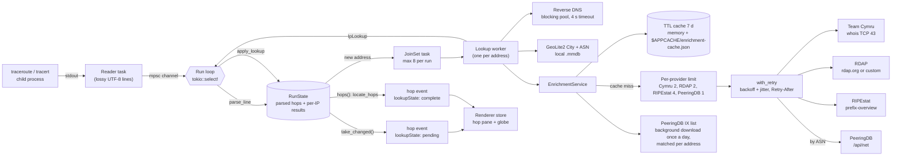
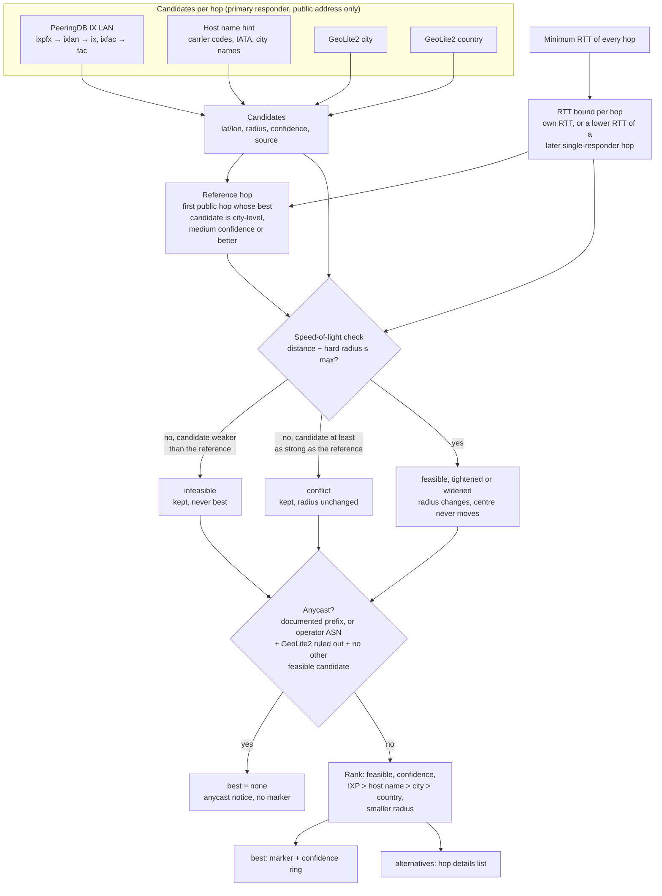
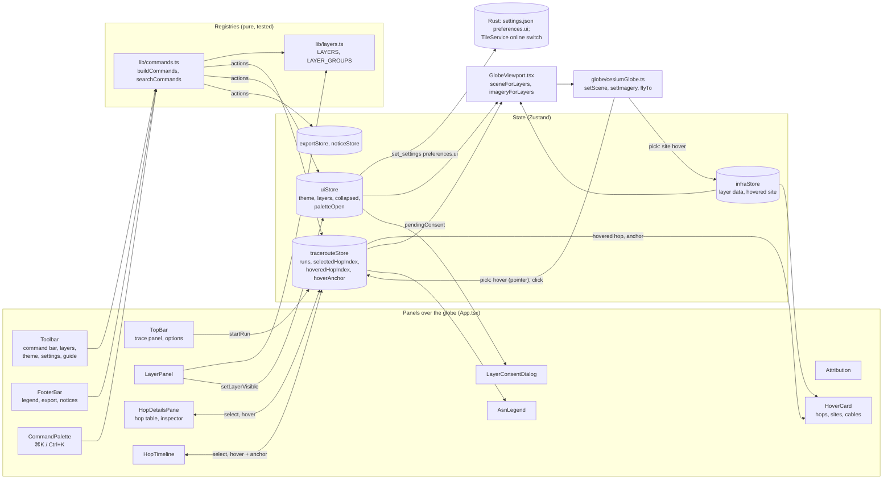
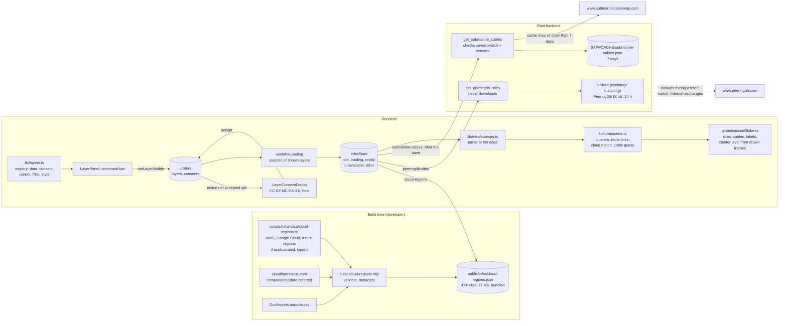
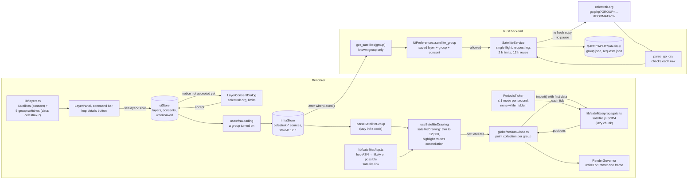

# VisTracer architecture

VisTracer is a Tauri v2 app. The Rust backend (`src-tauri/`) runs the
traceroute binary and looks up each hop. The React renderer (`src/renderer/`)
draws the route on a globe and lists the hops. They talk over Tauri IPC
(`src/common/bridge.ts`, `src/common/ipc.ts`).

## Hop pipeline

The read loop never waits for a lookup. It parses each output line, emits the
hop at once, and hands new addresses to lookup tasks. Each finished lookup
emits an update for the hops that use that address.



### Steps

1. **Plan the command** (`commands/traceroute_command.rs`). `SystemLocator`
   finds the binary through `PATH`, then `/usr/sbin`, `/usr/bin`, `/sbin`,
   `/bin`, `/usr/local/*` (or `%SystemRoot%\System32` on Windows). A missing
   binary gives an install command. Targets that start with `-` or contain
   other characters than letters, digits, `.`, `-`, `:`, `_`, `%` are rejected.
2. **Spawn and read** (`commands/traceroute.rs`). A reader task forwards
   stdout lines. macOS TCP traces need root, so they run through the
   `osascript` administrator prompt and write to a temp file that the reader
   follows. The elevated binary must be a root-owned file in a root-only
   system directory; `PATH` is not used for it. The root shell creates the
   output file itself (`set -C`, one redirection), so a symlink planted in
   the temp folder cannot make root overwrite another file. On Windows,
   `tracert` starts without a console window.
3. **Parse** (`commands/traceroute_parse.rs`). Every responder on a line is
   kept: Linux prints load-balanced responders on one line, macOS prints them
   on indented lines without a hop number, Windows puts the RTT columns before
   the address. Regexes compile once (`LazyLock`).
4. **Render hops** (`commands/run_state.rs`). `RunState` keeps the parsed
   lines and the per-address results. Every `HopResolution` is rendered from
   that state, so lines and lookups can arrive in any order. Only hops whose
   value changed are emitted.
5. **Look up** (`commands/lookup.rs`). The first responder of a hop gets a
   full lookup (reverse DNS, GeoLite2, providers). Other responders of a
   multipath hop only get reverse DNS. An address that later becomes a primary
   responder is upgraded to a full lookup.
6. **Locate** (`geoloc/estimate.rs`). Every time hops are rendered, the
   location of each hop is estimated across the whole run (see
   [Hop locations](#hop-locations)). A new hop can change earlier hops (a
   lower RTT tightens their bound); such hops are emitted again.
7. **Finish**. After the process exits and the lookups finish, the backend
   emits the completed run and writes the provider cache to disk. Cancel
   kills the process and aborts the lookups in flight, also when the process
   has already exited and only lookups are left. Exception: a macOS TCP run
   is started as root through `osascript`. Cancel kills `osascript`, but the
   root `traceroute` keeps running until it ends (stopping it needs root);
   its output is ignored.

### Linux privileges

ICMP (`-I`) and TCP (`-T`) probes need raw sockets on Linux. When such a run
fails with a permission error before the first hop line, VisTracer runs the
trace again with UDP probes and adds a notice to the run. The notice shows a
`setcap cap_net_raw+ep` command only when the binary is a root-owned system
binary. For TCP, `tcptraceroute` is used for IPv4 when it is installed;
otherwise `traceroute -T`.

## Enrichment

`commands/integrations.rs` holds one parser per provider (tested against real
responses in `src-tauri/fixtures/providers/`) and the merge.

| Provider | Key | Gives | Default |
| --- | --- | --- | --- |
| GeoLite2 (local) | IP | coordinates, city, country, ASN, AS org | on when databases are configured |
| Team Cymru | IP | origin ASN, BGP prefix, country, registry, AS name | on |
| RDAP | IP | network name and handle, registrant org, CIDR, country, registry | on |
| RIPEstat | IP | announced prefix, origin ASNs and holders | on |
| PeeringDB | ASN | network type, scope, peering policy, IXP and facility counts | off |
| PeeringDB IX list | IP (local match; only the public list is downloaded) | IX peering LAN that contains the address, IX position | on (own switch, `ixMatching`) |

Rules:

- Private, CGNAT (100.64/10), link-local, loopback, multicast,
  documentation, benchmarking/"fake IP" (198.18/15), reserved (240/4) and
  IPv4-mapped private addresses are never sent to a provider.
- An empty Team Cymru reply is a retryable error and is not cached.
- Each provider call goes through the cache, then the provider's concurrency
  limit, then the cache again (another hop may have filled it), then
  `with_retry`. Retries happen on HTTP 429, 5xx, timeouts and connection
  errors: 3 attempts, exponential backoff from 500 ms to 8 s with jitter, and
  a server `Retry-After` is honoured. The request, retries included, has a
  25 s budget.
- A lookup waits at most 25 s for a free provider slot. If none frees up, the
  provider is marked `skipped` ("Not queried: …"). This wait does not count
  as a provider failure.
- After 3 failed requests in a row, a provider is skipped for 60 s (its
  status says so). A provider that is down therefore costs a few timeouts per
  run instead of one timeout per hop.
- "No record" answers are cached too, so repeated misses do not hit the
  network. Errors are not cached. "Force fresh lookups" skips cache reads.
  RDAP answers are cached per base URL, so switching RDAP servers takes
  effect at once.
- A failed provider reports `status: "error"` with a message. The hop keeps
  the GeoLite2 data and the data of the other providers. The hop pane shows
  "N sources failed" and the message for each.
- Merge (`merge_asn`): the ASN comes from Team Cymru, then RIPEstat, then
  GeoLite2 (live BGP before the database snapshot). The name only comes from
  a source that agrees on that ASN, then PeeringDB, then the RDAP registrant.
  The prefix comes from RIPEstat (when announced), then Team Cymru, then RDAP.

## Hop locations

GeoLite2 often places a router at its operator's registered address or at a
country centroid. `geoloc/` collects every location candidate for a hop,
removes the ones that the speed of light rules out, and ranks the rest. The
hop carries all of them in `HopLocation`: `best` (drawn on the globe),
`alternatives` (listed in the hop details), the IXP match, the host name
hint and an anycast notice.



### Candidates

| Source | Centre | Radius | Confidence |
| --- | --- | --- | --- |
| PeeringDB IX LAN (`geoloc/ixp.rs`) | centre of the IX facilities; the IX city when no facility has coordinates | distance to the furthest facility, at least 25 km (city fallback 50 km) | high up to 150 km, medium up to 500 km, low beyond |
| Host name hint (`geoloc/hostname.rs`) | airport of the named city (`data/airports.csv`) | 50 km | high for a known carrier's scheme or a matching country label, medium for generic codes, low for a bare 3-letter code |
| GeoLite2 city | record coordinates | `accuracy_radius` (200 km when missing) | medium up to 100 km, low beyond |
| GeoLite2 country | country centroid | `accuracy_radius` (1000 km when missing) | low |

Host name rules:

- A token counts only as a whole label or a whole `-` piece of a label,
  with at most a site number after it (`fra03`, `Frankfurt1`, `lsanca07`).
  The registered domain (`cogentco.com`, `prod-infinitum.com.mx`) is not
  read.
- Router role and interface tokens that are also airport codes (`ccr`
  Concord, `mag` Madang, `ibr` Ibaraki, `pos` Port of Spain) are never read
  as places. Other host name words that are also airport codes (`cgn`
  Cologne, `man` Manchester, `sat` San Antonio) are only read in a known
  carrier's site label.
- Known carrier domains (NTT, Cogent, Arelion, Hurricane Electric, Lumen,
  Tata, Zayo, GTT, Google, Microsoft, Verizon, Comcast) raise the scheme
  that carrier uses to high confidence and add carrier site codes (Arelion
  `ffm`, HE `fmt`). Where the site label has a fixed position (Cogent
  `man01.atlas`, Microsoft `par21.ntwk`), only that label is read.
- A bare 3-letter code, or the code of a small (medium) airport outside a
  known carrier's names, needs another source to agree on the country.
  Example: Tele2's `avk1` is a site name, not Arvaikheer in Mongolia.
- A 2-letter label right after the token (`lsanca07.us`, `lhr15.uk`,
  `ashburn.va`) must agree with the place's country or US state; if it names
  another country, the hint is dropped.
- Two different places at the same confidence cancel out.

The fixture list `src-tauri/fixtures/hostnames/hints.txt` holds the
positive and negative cases, including host names from real traces.

### RTT check

Light in fibre covers about 200 km per millisecond one way, so a reply after
`rtt` ms comes from at most `rtt / 2 × 200` km away (`reach`). Every probe
starts at the user's machine, so for the reference hop `r` and a hop `h`:

`max = reach(rtt_r) + reach(rtt_h) + hard radius of r + 100 km slack`

A candidate fails the check when `distance(r, candidate) − hard radius >
max`. GeoLite2's `accuracy_radius` is a 67 % radius for end users, not
routers, so the hard radius of a GeoLite2 candidate is twice its radius as a
margin; that is a heuristic, not a guarantee. For IX and host name
candidates the hard radius is the radius itself.

**The reference cannot veto stronger evidence.** The reference location is
itself an estimate, usually GeoLite2, and GeoLite2 often has a router's
registered address. So a candidate that fails the check is only
**infeasible** (kept, never best) when its confidence is lower than the
reference's. A candidate that is at least as strong as the reference gets
the **conflict** verdict: it stays in the ranking with its radius and
confidence unchanged, and the hop details say that it conflicts with the
reference and that one of the two is wrong. Example: hop 2's GeoLite2 record
says Mumbai (medium), a Tata router 5 ms away is named `dl1-delhi` (high).
The Delhi hint fails the check (1,139 km, 840 km allowed) but stays best,
and the hop stays on the globe. A GeoLite2 country centroid (low), such as
8.8.8.8 at the US centroid, is still ruled out.

What the check removes therefore depends on the reference. The usual
reference is the first hop's GeoLite2 city record (medium). Against it, only
low-confidence candidates are ruled out: GeoLite2 country centroids and
GeoLite2 city records with a radius above 100 km. A GeoLite2 city record of
another hop with a radius up to 100 km is also medium, so it is kept as a
conflict even when it is a registered address far from the path. A conflict
ring on the globe uses the low-confidence style, and the hop table shows a
"conflict" tag.

A feasible candidate is **tightened** when the whole area within `max` of
the reference lies inside its radius (the radius shrinks to
`distance + max`), and **widened** when that area starts beyond its radius
(the radius grows, at most to the hard radius). A widened candidate drops
to low confidence only when it is weaker than the reference; otherwise it
would lose the ranking to a weaker record, which is what the conflict rule
prevents. The check never moves a candidate.

- **Reference hop.** The app does not know the user's own address, so the
  reference is the first public hop whose best candidate has a radius of at
  most 200 km and at least medium confidence. Its RTT puts the user within
  `reach(rtt_r)` of it, which is part of `max`. The hop details say which
  hop is the reference. Its other candidates are not checked.
- **Primary responder.** A hop's candidates describe its first responder,
  so the bound uses that responder's RTTs, not a faster path of a
  load-balanced hop.
- **Later hops.** A router on the path is no further away than any hop
  reached through it, so a hop's bound is the lowest RTT of itself and the
  later hops. This helps routers that answer slowly (ICMP generated in
  software). It is used only when the hop and the later hop each have one
  responder, because a load-balanced path may not pass the router.

### Anycast

No registry provider flags anycast, so `geoloc/anycast.rs` uses two
bundled lists:

- **Documented anycast prefixes**: public DNS resolvers (Cloudflare, Google,
  Quad9, OpenDNS) and the 13 DNS root servers. An address in one of them is
  anycast whatever the RTT says.
- **Anycast operators**: ASNs that announce their address space from many
  sites (Cloudflare, Fastly, Quad9, OpenDNS, PCH). These networks also have
  unicast router addresses, so the hop counts as anycast only when the RTT
  rules out its GeoLite2 location and no IX or host name candidate is
  feasible. A feasible IX or host name candidate means a unicast router.

An anycast hop has no best estimate: no marker, no ring and no arc. The hop
details say why and give the RTT bound ("the site that answered is at most
740 km from hop 2"). Example: 8.8.8.8 answers in 4 ms from Mumbai, while
GeoLite2 places it at the US centroid about 13,000 km away.

### PeeringDB IX list

Exchange matching has its own switch (`integrations.ixMatching`, "Internet
exchanges" in the settings), on by default and separate from the PeeringDB
switch, which only controls the per-ASN lookups that send hop data. Settings
files saved before the switch existed load with it on. When it is on,
`commands/ix_list.rs` downloads five lists (`ixpfx`, `ixlan`, `ix`, `ixfac`,
`fac`, with `fields=` to keep them small; `ix` and `fac` include the names,
places and counts that the exchange and data centre layers show) one at a
time, with the saved
PeeringDB API key when there is one, the PeeringDB slot, retries, and 2 s
between requests as PeeringDB asks. The download sends nothing about the
user's route; matching happens on the user's machine. The joined dataset
(on 2026-10-24: 1,332 exchanges and 2,658 prefixes, about 340 KB of JSON;
since phase 5 also 5,279 facilities with a name and coordinates, about
0.98 MB more, from a `fac` download of 1.17 MB) is kept in the provider
cache for 24 h and written to disk as soon as the download ends. A dataset
saved by the previous version (no facilities, `version` below 2) is used
and refreshed in the background like an expired one.

- The download runs in its own task. A lookup never waits for a refresh: a
  list up to 7 days old is used at once, and the provider status says that
  a newer one is downloading. Only when there is no list at all does a
  lookup wait for the download, for at most 25 s; after that the IX source
  is "skipped" for that hop, not "failed".
- A cancelled run does not stop the download, so the lists already fetched
  are not thrown away.

- PeeringDB allows one identical anonymous request above 100 kB per hour.
  "Force fresh lookups" therefore does not download the list again, and a
  smoke test that reran within the hour got HTTP 429.
- After a failed download there is no new attempt for 15 min. A list up to
  7 days old is used meanwhile; the provider status says the refresh
  failed.
- An HTTP 429 from PeeringDB is final: no retry within seconds, and no new
  download for `max(1 h, Retry-After)`, at most 24 h, because the limit is
  per hour. The cap keeps one server answer from turning exchange matching
  off for the session. This backoff is kept in memory only: after a restart
  within the hour, the app sends one more request, which gets a 429 again.
- The provider cache keeps entries for at least 7 days, also when the
  provider TTL (`cacheSettings.enrichmentTtlMs`) is shorter, so a short TTL
  cannot make the app download the list more than once a day. The cache
  holds at most 4,000 entries and drops the oldest first; the IX list is one
  entry and at most a day old in normal use.
- IX LAN prefixes shorter than /16 (IPv4) or /32 (IPv6) are treated as data
  errors and ignored.

### Known limits

- A wrong reference location can still rule out correct candidates that
  are weaker than the reference. Example: GeoLite2 places the user's first
  public hop in Mumbai (medium) while the user is in Delhi; a low-confidence
  GeoLite2 record that correctly says Delhi for a hop 3 ms away is ruled
  out. Candidates as strong as the reference are kept as conflicts.
- The reverse also holds: with a medium GeoLite2 reference, a wrong
  medium GeoLite2 record of another hop (a registered address with a radius
  up to 100 km, for example "Ashburn ±20 km" for a router 3 ms from Mumbai)
  is kept as a conflict and drawn. The anycast-operator rule has the same
  limit: it applies only when GeoLite2 is weaker than the reference.
- Remote peering: an address on an IX peering LAN can belong to a router
  far from the exchange (connected over a long-distance link). The IX
  candidate is still high confidence up to 150 km.
- The later-hop bound treats a hop as single-responder after its probes
  (usually 3). Classic UDP traceroute changes the flow per probe, so with
  per-flow load balancing (ECMP) a later hop's probe may not have passed
  this router, and the bound can be too tight.
- RTT gives only an upper bound on distance. A router 150 ms away can be
  anywhere within 15,000 km, so far hops are rarely filtered.
- Host name hints depend on naming schemes that carriers can change. The
  curated tables cover the large carriers only.

## Globe

The globe is CesiumJS, used directly (no wrapper library). React state goes
through pure functions to a scene description; one adapter module draws it
with Cesium primitives. A render governor decides when Cesium draws. Imagery
comes from tiles bundled with the app and, when zoomed in, from NASA GIBS
through a tile cache in Rust.

```mermaid
flowchart LR
    subgraph renderer["Renderer (React)"]
        store[("tracerouteStore<br/>run, selectedHopIndex,<br/>hoveredHopIndex")]
        pane["HopDetailsPane<br/>row hover, click"]
        viewport["GlobeViewport.tsx"]
        mapping["lib/globe.ts (pure)<br/>buildGlobeScene: markers, arcs,<br/>rings, anycast reach, labels<br/>nextCameraFocus, planFlight"]
        adapter["globe/cesiumGlobe.ts<br/>(only module that imports Cesium)"]
        governor["lib/renderGovernor.ts<br/>wake, idle sleep, fps cap,<br/>hidden or minimized pause"]
        imagery["lib/imagery.ts<br/>layer config, night fade,<br/>bundledOnlyHeight (flight floor),<br/>OnlineImageryGate"]
    end
    subgraph cesium["CesiumJS"]
        widget["CesiumWidget<br/>requestRenderMode, own render loop off"]
        prims["PolylineCollection, PointPrimitiveCollection,<br/>LabelCollection"]
        layers["Imagery layers<br/>1 Black Marble (bundled, night)<br/>2 Blue Marble (bundled, day)<br/>3 Blue Marble (online, level 5+)"]
    end
    subgraph rust["Rust backend"]
        scheme["vistiles URI scheme handler"]
        tiles["TileService<br/>parse, allowlist, single flight,<br/>3-failure pause"]
        disk[("TileStore $APPCACHE/tiles<br/>500 MB, LRU")]
        http["HttpFetcher<br/>redirects only to allowed hosts"]
    end
    gibs["NASA GIBS WMTS<br/>gibs.earthdata.nasa.gov"]
    bundled[("./imagery/ tiles<br/>levels 0-4, 6.5 MB")]

    store --> viewport
    pane <-->|hover, select| store
    viewport --> mapping --> adapter
    adapter -->|"pick: hover, click"| store
    adapter --> widget --> prims
    widget --> layers
    governor -->|"tick: resize + render"| widget
    adapter -->|"wake: data, input, resize,<br/>Cesium requestRender"| governor
    imagery --> adapter
    layers -->|levels 0-4| bundled
    layers -->|"level 5+: vistiles://localhost/blue-marble/z/y/x.jpg"| scheme
    scheme --> tiles --> disk
    tiles -->|miss| http --> gibs
```



### Scene mapping

`buildGlobeScene(hops, selected, hovered)` in `src/renderer/lib/globe.ts`
turns hops into plain objects in degrees and metres. The adapter only
converts them to Cesium types. Tests cover the mapping without WebGL.

| Item | Rule |
| --- | --- |
| Marker | One per hop with `location.best`. Size and outline by emphasis: normal, hovered, selected (drawn last, on top). |
| Arc | Great circle between consecutive located hops, raised in the middle (sine profile, peak 12 % of the distance, 2 km to 1,500 km). Colour by the first hop's latency band; with **Network colours** on, by network (see [Infrastructure layers](#infrastructure-layers)). Hops less than 1 km apart get no arc. |
| Confidence ring | Circle on the sphere at the estimate's radius in km, segments at most 50 km long. Solid for high confidence, dashed and fainter for medium and low; a `conflict` verdict uses the low style. No ring above 5,000 km. |
| Anycast reach | An anycast hop has no marker, ring or arc. When its RTT bound and reference hop are known, a dotted circle around the reference hop's estimate shows where the answering site can be ("within 740 km of hop 2"). |
| Label | The selected and the hovered hop: "6 · DE-CIX Frankfurt". |
| Country borders | Natural Earth 1:110m, drawn once from `world.geojson`. |

Camera (`nextCameraFocus`): it flies to a newly selected hop, else to the
newest hop that got a location during the run; enrichment updates of the
same hops do not move it. Flights keep the user's zoom unless the hop's ring
would not fit (`flyHeight`). With `prefers-reduced-motion` the camera jumps.

Flights frame the hop in the area the panels leave free. Panels mark the
edge they cover with `data-globe-inset` (trace panel: top; hop pane:
right; timeline and status bar: bottom; network legend: left), and
`measureInsets` in `GlobeViewport.tsx` measures them when a flight starts.
`planFlight` then moves the camera target by half the covered pixels times
the ground size of a pixel at the centre (`framedTarget`, `kmPerPixel`;
Cesium's `fov` spans the larger side of the canvas, the height in a window
taller than wide), so the hop shows at the centre
of the free area, and the ring must fit the free area. That is exact near
the ground and an estimate far out, where the Earth curves away. A free
area under 30 % of the canvas is ignored. The flight floor (below) does
not change. During a GIF or WebM export, flights centre the hop in the
whole canvas: the recording has no panels.

During a GIF or WebM export the camera does not take user input
(`setInputEnabled(false)`), so a drag or zoom cannot get into the video.
Hop selections from the globe, the timeline, the hop table and the command
bar are ignored too (`selectHopByUser`; "Go to hop" says "An export is
running."): the export moves the selection itself, and a flight to another
hop would be recorded.
The lock uses `enableRotate`, `enableZoom`, `enableTilt` and
`enableTranslate` of the camera controller, not `enableInputs`: every
Cesium flight sets `enableInputs` to false when it starts and back to true
when it ends (`CameraFlightPath`), which would unlock the camera after the
first hop.

Camera moves the app makes (following a trace, selecting a hop, the per-hop
moves of a GIF or WebM export) never load online tiles: online tiles show
NASA the areas they cover, and a camera that follows a trace would trace the
route for NASA. `planFlight` keeps every such move at or above the floor
from `bundledOnlyHeight`. That is the camera height at which Cesium's
screen-space error of a level 4 tile (the last bundled level) stays below
`Globe.maximumScreenSpaceError`, so no level 5 tile (the first online level)
is selected:

`floor = 1.15 × levelError(4) × max(view width, view height, screen width, screen height) / (maximumScreenSpaceError × 2 tan(fov / 2))`

`levelError(4)` is 4,892 m for the ellipsoid terrain and `fov` is 60°, so the
floor is about 4,700 km for a 1920 px wide screen. The screen size is
included so that a larger window later does not cross the floor at the same
height. From below the floor, the camera first rises over the place the
user zoomed into, then moves to the hop at the floor or higher.

The online layer is also hidden from the start of such a flight
(`OnlineImageryGate`), so the wider view during the rise loads nothing. It
stays hidden after the flight until the user zooms, drags or tilts the globe
(wheel, or a pointer move with a button held after a press on the globe;
a press that started in a panel does not count; not during a flight, not
while input is locked). So a view the app chose never loads online tiles,
even when the window is moved to a larger monitor later and the floor no
longer holds. The layer is hidden at start-up too: Cesium refines the
14,000 km start view past level 4 in a view wider than about 6,600 px, so
the start view loads nothing until the user first moves the camera. Only the
user's own camera moves load online tiles.

During the move step of a two-step flight, Cesium can apply user input: the
rise step's completion turns `enableInputs` back on after the move step has
started (`CameraFlightPath` wraps the `complete` callback). The flight sets
the camera again on every frame, and the gate does not count that input, so
the layer stays hidden.
`scripts/globe-check/check.mjs` (below) counts the tile requests to show it.

Picking: the arcs end at the markers and are drawn after them, so a pick that
hits an arc looks underneath (`drillPick`, 4 deep) for a marker, ring or
reach. Hovering is checked at most every 50 ms and never while dragging.

### Render governor

Cesium runs with `requestRenderMode`, so it draws a frame only when
something changed. `RenderGovernor` also owns the `requestAnimationFrame`
loop that asks Cesium for those frames:

- The loop runs only after a wake: scene data, pointer down, drag, wheel,
  resize, the 10-minute sun update, or any Cesium `scene.requestRender()`
  (tile loads, worker results). It sleeps after 20 ticks that drew nothing.
  While tiles load, Cesium draws every tick, so the loop stays awake until
  they are in.
- A periodic update that needs one frame (the satellites, at most once a
  second) uses `wakeForFrame()`: the loop sleeps right after the tick that
  draws, unless another wake came meanwhile.
- At most 60 ticks per second; 30 on battery where the webview reports it
  (`navigator.getBattery`, Chromium only).
- No ticks while the page is hidden (Page Visibility) or the window is
  minimized (Tauri `onResized` + `isMinimized`, for webviews that do not
  report minimized windows as hidden).
- Costs that add nothing are off: star box, sun and moon, ground atmosphere,
  fog, FXAA, HDR, shadows, order-independent translucency. The canvas uses
  the screen's pixel density up to 2x, and MSAA only below 1.5x.

An idle globe therefore runs no animation frames at all; with the
satellites on, one per second.

`scripts/globe-check/check.mjs` checks this on the production build in
headless Chrome, with the app's CSP and a fake Tauri IPC
(`scripts/globe-check/mock-ipc.js`, three fixture traces and synthetic
infrastructure and satellite data; the browser harness is `browser.mjs`).
It counts animation frames, frames that drew, WebGL draws, compositor
frames (from a Chrome trace), online tile requests, the layers' IPC calls
and file requests, and controls with no accessible name (Chrome's
accessibility tree), and exits 1 when a check fails. It needs a local
Chrome (`CHROME=...`), so it is not part of CI. `ui-shots.mjs` uses the
same harness to take screenshots of every UI state (dark, light,
960 x 640, and reduced motion and transparency) for review; it checks
nothing.

```bash
npm run build
node scripts/globe-check/check.mjs [output dir]
node scripts/globe-check/ui-shots.mjs [output dir]
```

Result of the runs on 2026-10-25 and 26, after the phase 6 satellites
(50 checks pass). The request counts of user zooms differ from run to run
(for example, the first user zoom made 49 to 89 requests and the next one
103 to 254 in the runs of phases 4 and 5); the checks only need more than 0.
Every count that must be 0 was 0 in every run.

Each idle window starts only after the "Detailed imagery is unavailable"
notice is gone, up to 35 s after the last action (see below). So the check
finds continuous idle work, but not a short animation that stops within
that time after an action.

- A 7680 x 2160 window at DPR 1 made 0 online tile requests in 12 s with no
  input. Control: with the gate starting open, the same step made 161.
- 0 animation frames and 0 WebGL draws in each 5 s idle window, and 0
  compositor frames or paints with the glass panels over the idle globe
  (a control with one animated element made 243); a 20-step drag ran
  about 60 frames, changed the canvas, then stopped. An idle window starts
  after the "Detailed imagery is unavailable" notice is gone: in headless
  Chrome every online tile fails, and the removal of that notice 30 s
  later is one repaint.
- A user zoom made 50 online tile requests. Selecting a hop, following a
  trace and exporting, each from that zoomed-in view, made 0. Growing the
  window from 1280 to 3840 px after those app moves made 0; the next user
  zoom made 237.
- With **Online imagery** off in the layer panel, a user drag to new ground
  and a zoom made 0 requests; switched on again, the same view made 25.
- A 20-step drag during a WebM export made 0 WebGL draws and left the
  canvas pixels unchanged (compared with `toDataURL`, because the panels
  float over the canvas).
- With the infrastructure layers off (the default), the whole session up
  to this point made 0 exchange list calls, 0 cable map calls and 0
  requests for a layer file. Switched on (exchanges, data centres, cloud
  regions, network colours) after an app move: 1 exchange list call, 1
  request for `infra/cloud-regions.json`, 0 online tiles, and an idle
  window with 0 frames, draws and paints.
- Submarine cables: the notice names CC BY-NC-SA 3.0 and
  www.submarinecablemap.com; 0 cable map calls after Cancel, 1 after
  consent, still 1 after the layer was off, the camera moved and the layer
  was on again; an idle window with the cables on drew nothing; 0 requests
  to TeleGeography's host (the renderer never contacts it).
- Satellites: with them off for the whole session up to this point, 0
  `get_satellites` calls, 0 requests for the SGP4 chunk and 0 to
  celestrak.org. The notice names celestrak.org and the 2 hour limit; 0
  calls after Cancel, 3 after consent (the default groups), the SGP4 chunk
  once. With them on: 10 frames drawn and 10 animation frames in 10 s, 0
  online tiles; page hidden: 0 frames in 5 s; off again: an idle window
  with 0 frames and paints; off and on: still 3 calls.
- Screen readers: no dialog in the page before one is opened (Cesium's
  credit lightbox was one, see Security), and every control has an
  accessible name at start and with a trace, the layer panel and the hop
  details.

Control runs, each with one fix removed: without the floor and the hidden
layer, the three app moves made 166, 99 and 42 requests; with the online
layer shown again when a flight ends, the larger window made 92; with the
lock on `enableInputs`, the drag during the export made 838 draws and moved
the globe.

### Imagery and day/night

| Layer | Tiling | Levels | Shown |
| --- | --- | --- | --- |
| Black Marble 2016, bundled | geographic, 256 px JPEG | 0–4 | dark side, far out |
| Blue Marble, bundled | geographic, 256 px JPEG | 0–4 | day side; dark side close up |
| Blue Marble, online | Web Mercator (GIBS `GoogleMapsCompatible_Level8`) | 5–8 | as the bundled day layer, from terrain level 5 |

Cesium places the sun from the clock (set to the wall clock on every drawn
frame and every 10 minutes), lights the globe, and fades the lighting out as
the camera comes closer than about 10,000 km to the Earth's centre. Cesium
picks day or night layers by sun direction only, so a close view of the dark
side would show blurred night tiles under full lighting.
`nightImageryShare` fades the night layer out on the same distance scale,
so close views show the day imagery (and its online tiles) on both sides.
The night layer is brightened 3x because Cesium darkens the dark side to
30 %.

With no network, the bundled levels are magnified when zoomed in further,
and the globe shows "Detailed imagery is unavailable (offline?)" for 30 s
after a failed tile. Outside the desktop app (a plain browser) there is no
`vistiles` scheme, so only bundled imagery is used.

### Tile cache

`src-tauri/src/commands/tile_cache.rs`, served through the asynchronous
`vistiles` URI scheme (`vistiles://localhost/...` on macOS and Linux,
`http://vistiles.localhost/...` on Windows).

- The renderer names a layer and a tile: `/{layer}/{z}/{y}/{x}.{ext}`. The
  layer must be in `TILE_LAYERS`, the numbers decimal and in range, the
  extension the layer's. The request host must be the scheme's own. The
  upstream URL is built in Rust from constants and the parsed numbers, and
  its host must be in `ALLOWED_UPSTREAM_HOSTS`; redirects are followed only
  to those hosts. The scheme is not a proxy. Only GET and HEAD are served;
  other methods get 405.
- Cache: `$APPCACHE/tiles/{layer}/{z}/{y}/{x}.jpg`, at most 500 MB
  (decimal). An in-memory index (built by scanning the folder on first use,
  in file write order) tracks sizes and last use; past the cap the least
  recently used tiles are deleted down to 90 %. Writes go through a unique
  temporary file and a rename (`src-tauri/src/atomic_file.rs`, shared with
  the provider cache), so two writers of one tile, or two app instances,
  never leave a torn file. A crash leaves at most `*.tmp` files, which the
  next scan deletes.
- One download per tile at a time; concurrent requests for the tile wait
  and then read the cache.
- Only a 200 response with the layer's content type and image signature
  (JPEG `FF D8 FF`), up to 2 MB, is stored. 404, other statuses, error pages
  and network errors are passed on and never cached.
- After 3 failed upstream requests in a row (network, timeout, 5xx, 429),
  tile requests fail at once for 30 s instead of each waiting for a timeout.
- **Integration settings → Globe imagery** shows the cache size and clears
  it (`get_tile_cache_info`, `clear_tile_cache`). Clearing moves the folder
  aside and deletes it.

## UI shell

The globe fills the window. The controls float over it on translucent
("glass") panels in a CSS grid (`.hud` in `modules/app/app.css`) that lets
pointer events through to the globe; only the panels take input. Opening or
collapsing a panel never resizes the canvas, so it wakes no globe frames.



### Panels and state

| Panel | Place | Collapses (saved) |
| --- | --- | --- |
| Trace panel: target, protocol, Trace/Cancel; options (max hops, timeout, probes, force fresh, recent runs, lookup switches) | top left | options, collapsed by default |
| Toolbar: command bar, Layers, theme, settings, guide | top right | no |
| Layer panel | under the toolbar | yes, closed by default |
| Hop pane: hop table and the selected hop's details | right | to a "Hops (n)" tab |
| Hop timeline | lower left | yes |
| Network legend (while **Network colours** is on) | left, above the timeline | no |
| Status bar: latency legend, GeoLite2 state, Export route, notices | bottom left | no |
| Credits | lower right corner | opens on demand |

- **One source of truth.** The trace store holds the selected and the hovered
  hop. The globe, the hop table and the timeline write and read the same two
  values, so they stay in step. A hover from the globe or the timeline also
  stores an anchor (the pointer, or the hop's rectangle in the timeline); the
  hover card shows only when there is an anchor, so a hover in the hop table
  highlights without a card.
- **Saved UI state.** `uiStore` keeps the theme, the layer switches, the
  collapsed panels and the layer notices the user accepted (`consents`) in
  `preferences.ui` (`UiPreferences` in `commands/persistence.rs`): ids are
  checked (1–40 lowercase letters, digits, dashes; at most 64 per map), and
  ids this version does not know are kept. A saved section is read field by
  field, like the renderer's `normalizeUiPreferences`: a field that does not
  parse (for example a theme that a newer version added) falls back to its
  default and a bad entry is dropped, so the other choices, including
  "Online imagery: off", stay; the rest of `settings.json` is never dropped.
  Choices made while the file loads win, and writes are queued so the last
  one carries the latest state. `whenSaved()` also waits for a read in
  flight, so a notice accepted during start-up is written before the
  backend is asked for the layer's data. When the saved choices cannot be read, the
  app uses the defaults, says so, and writes nothing for the rest of the
  session, so it never replaces the saved choices with defaults.
- **Design tokens** (`styles/tokens.css`): colours, radii, blur, spacing,
  type scale and durations, dark by default and light with
  `data-theme="light"` on `<html>`. `prefers-reduced-motion` sets every
  duration to 0 (scrolls jump, globe flights already jump);
  `prefers-reduced-transparency` makes the panels solid with no blur.
  `styles/__tests__/tokens.test.ts` checks 4.5:1 for every text token against
  the worst case behind the glass (dark glass over white imagery, light glass
  over black space) and on solid panels. The globe looks the same in both
  themes, so text drawn straight on it uses two theme-independent tokens.

### Layer registry

`lib/layers.ts` lists the switches of the layer panel. The panel, the command
bar and the globe only read it.

| Layer | Group | Target | Default |
| --- | --- | --- | --- |
| Route arcs, hop markers, confidence rings, anycast reach, labels | Route | `scene`: drops the items from the `GlobeScene` (`sceneForLayers`) | on |
| Network colours | Route | `style`: `buildGlobeScene(..., { asnColors })` | off |
| Internet exchanges, data centres, submarine cables | Infrastructure | `scene` items `exchanges`, `facilities`, `cables` | off |
| Cloud regions | Cloud | `scene` item `cloudRegions` | off |
| AWS, Google Cloud, Azure, Cloudflare | Cloud (under Cloud regions) | `filter`: hides one provider before clustering (`hiddenFilterKeys`) | on |
| Satellites | Space | `satellites`: the adapter's satellite groups (`setSatellites`), see [Satellites](#satellites) | off, with a notice |
| Starlink, GPS, space stations; OneWeb, geostationary | Space (under Satellites) | `satellites` with a group: `satelliteGroupsForLayers` | on; off |
| Day and night | Globe | `imagery`: `setImagery({ dayNight })`, no lighting from the clock, no night layer | on |
| Online imagery | Globe | `imagery`: `setImagery({ online })`, see below | on |

An entry can also have:

- `parent`: a child switch, shown indented, with an effect only while the
  parent is on. Showing a child from the command bar shows the parent too.
  `defineLayers` types it: a parent that is not a registry id fails the
  typecheck.
- `data`: the source the layer loads when it is first shown
  (`peeringdb-sites`, `cloud-regions`, `submarine-cables`,
  `celestrak-<group>`). The panel shows
  that source's state under the switch (loading, nothing yet and why, a
  failure, or a note).
- `consent`: a notice the user must accept before the layer is shown the
  first time (`LayerConsentDialog`). Until then the switch stays off; the
  answer is saved in `preferences.ui.consents`.
- `swatch` (marker colours shown in the panel) and `commandName` (the name
  in the command bar, such as "Show AWS regions").

To add a layer, add an entry with a new id, a group (add the group to
`LAYER_GROUPS` if it is new) and a target: a new `GlobeScene` item that a
scene builder fills and the adapter draws, a filter or style, or an imagery
option. The panel, the saved switches and the command bar pick it up with
no change. Unit tests check that the ids pass the backend's check, that
every scene item has a switch, and that the provider filters match the
providers of the cloud region snapshot.

**Online imagery off** means no online tile request at all, enforced in
three places:

1. The adapter removes the online layer from Cesium's imagery collection, so
   Cesium cannot ask it for a tile (`show = false` alone would also stop
   requests; removal does not depend on it).
2. `TileService` in Rust refuses upstream downloads while the switch is off
   (403, "Online imagery is off"); tiles already on disk are still served,
   which sends nothing anywhere. The switch is applied at start, before the
   webview can ask for a tile.
3. On is the default, and `OnlineImageryGate` still keeps the start view and
   every app-made view on bundled imagery.

Switched on again, the layer loads tiles for the view the user chose; after
an app move the gate still holds it until the user moves the camera.

### Command bar

`lib/commands.ts` builds every command from the app state: run the last
trace again, cancel, go to each hop, show/hide each layer and panel, switch
theme, export PNG/WebM/GIF or open the export dialog, open settings, clear
the tile cache, show the guide. A query that names a host ("trace x", or
text with a dot or colon) adds "Trace x", checked like `validate_target` in
Rust; the trace panel starts it with its current options
(`UI_EVENTS.START_TRACE`). A host with a dot or colon comes first; "trace
<word>" comes after the matching commands, so "trace again" still offers
"Run the last trace again" first. A command that cannot run is listed with
the reason and does nothing. No trace starts during an export (from the bar
or the trace panel): a new run would end the export's camera lock. The
toolbar buttons and the footer's Export route button run the same commands
by id. Layer commands use the registry's `commandName` ("Show AWS
regions"). A child switch reads "Show" while it shows nothing (its parent
is off), with "Also shows cloud regions", and the command turns on only
what is off; showing a layer with a notice opens the notice first.

Search: every word of the query must match, and the scores add up. A word
as one piece of the text scores highest (more at a word start), else its
letters in order, with runs of letters and word starts preferred. A match
in the title counts double over one that also uses the group, detail and
keywords.

Keyboard: ⌘K (macOS) or Ctrl+K opens and closes the bar (not over another
modal dialog). It is a modal dialog with a combobox over a listbox: arrow
keys move (wrapping), Enter runs, Escape closes, Tab keeps the focus in the
search field, a press elsewhere in the bar does not take the focus from
it, and the focus returns to where it was.

### Hop timeline and hover cards

- **Timeline** (`lib/timeline.ts`, `HopTimeline.tsx`): one column per hop
  with the average RTT as a bar on the run's scale (coloured like the arcs),
  a min-max whisker, a tick per probe of the first responder, loss above 0,
  and a three-step meter for the location confidence. A rise of the average
  RTT by 20 ms or more over the previous hop that answered is a latency jump
  (amber "+81"). It is a horizontal listbox with a roving tab stop: arrow
  keys, Home and End move the selection and the focus.
- **Hover card** (`lib/hoverCard.ts`, `HoverCard.tsx`): host name, address,
  ASN and holder, the place with source, confidence and radius, RTT, loss,
  the cloud match while cloud regions are on, and a note for anycast,
  private addresses, RTT conflicts and pending lookups. Over a site marker
  or a cable (when no hop is under the pointer) it shows the site
  (`lib/infra/siteCard.ts`): name, place, counts, what the route has to do
  with it, and the other sites of its cluster. It reads the stores only, so
  hovering sends no request.
  `placeCard` keeps it in the window: next to the pointer and flipped near
  the right and bottom edges, or centred above a timeline hop and below it
  near the top. It ignores the pointer and hides during exports (and is
  placed again when the export ends). Escape hides the card shown for a hop
  focused in the timeline and keeps the highlight (WCAG 1.4.13).

### Attribution

A chip in the lower right corner ("NASA, GIBS, CesiumJS") opens the list of
sources in `lib/attribution.ts`, consistent with
[third-party-data.md](./third-party-data.md), including the
acknowledgements that NASA GIBS and MaxMind GeoLite2 ask for. GIBS served
the bundled tiles too, so its credit and acknowledgement always show; while
online imagery is off, its entry adds "Online tiles: off". A credit with a
`layer` (typed `LayerId`) shows only while that layer is on:
TeleGeography's, with its licence and notice, while the submarine cables
are on, and CelesTrak's while the satellites are on. Their `chip` names
join the chip ("NASA, GIBS, CesiumJS, TeleGeography, CelesTrak"), and
their notices go into exports. satellite.js is always listed. Sources are
plain text: a link would open inside the app window.

### Cost of the glass panels

`backdrop-filter` over the WebGL canvas costs nothing while the globe is
idle: the canvas does not change, so the compositor reuses the blurred
backdrop. `scripts/globe-check/check.mjs` records a Chrome trace during each
5 s idle window and counts `DrawFrame`, `BeginFrame` and `Paint` events: 0
with the panels over an idle globe, while a control with one animated
element makes over 200. UI animations are CSS transitions on user actions
only; nothing animates while the app is idle.

## Infrastructure layers

Exchanges (IXPs), data centres, cloud regions, network colours and the
opt-in submarine cables are entries of the layer registry. Their data loads
the first time a layer that needs it is shown, never at start-up, and only
the cables send anything to a new host, after the user accepts a notice.



### Data

| Layer | Source | When it loads | Sends |
| --- | --- | --- | --- |
| Internet exchanges, data centres | The PeeringDB IX list in the provider cache (`get_peeringdb_sites`, from `IxStore`) | First shown; again after a trace when there was no list or an old one | Nothing: the command never downloads. Exchange matching downloads the list during traces, as in phase 2 |
| Cloud regions | `./infra/cloud-regions.json`, bundled | First shown | Nothing |
| Submarine cables | `get_submarine_cables` | First shown after the notice is accepted | One request to `www.submarinecablemap.com` when the saved copy is missing or older than 7 days |

- **Why the PeeringDB data is not bundled.** PeeringDB's Acceptable Use
  Policy says its data may not be passed on in bulk without its approval.
  The layers therefore show the list that each installation downloads for
  exchange matching (on by default), with more fields. With exchange
  matching off and no saved list, the layers say so and send nothing.
- **Parsing at the edge** (`lib/infra/sources.ts`): each source is
  `unknown` until parsed. A record with a wrong field is dropped and
  counted, and the loader logs the count; a wrong outer shape (or another
  snapshot layout) is an error shown under the switch.
- **Lazy code.** The parsers, clustering, route matching, site cards and
  the satellite drawing (`lib/infra/code.ts`, the `code` chunk) load with
  the first layer data (`infraStore.code`); until then the hooks return
  empty results. The globe adapter imports none of it (its hover styles
  are in `lib/globe.ts`), so with every layer off the page loads only the
  start-up and globe chunks (globe check).
- **Retry.** `useInfraLoading` asks for a layer's source when that layer is
  turned on. A source that failed, or had nothing yet (no exchange list),
  is loaded again then, also while another layer with the same source
  stays on. Hiding a layer keeps its data: showing it again makes no
  request (satellite data older than 12 hours is the exception, see
  [Satellites](#satellites)).
- **Cable opt-in, enforced twice.** The renderer opens the notice instead of
  turning the layer on, and asks the backend only after the switch and the
  consent are written (`uiStore.whenSaved`). The backend reads
  `preferences.ui` at each call (`UiPreferences::submarine_cables`): without
  the layer on and the notice accepted, it reads and sends nothing. It
  downloads one file (single flight), parses the GeoJSON at the edge
  (features without id, name or a valid line dropped; coordinates rounded
  to 0.01°), saves the compact result with `write_atomic`, and uses an
  older copy (with a note) for 10 minutes after a failed download.

### Drawing

- **Clustering** (`lib/infra/cluster.ts`): greedy by importance (networks
  at the site; for cloud regions, a region before a CDN data centre), with
  a spatial hash. A site joins the nearest seed within one cell, so each
  marker stands for an area and sits at a real site. The cell is 2^n km
  (1 km to 4,096 km), the smallest power of two at least 36 px wide at the
  centre of the view. The search for a seed covers every column of
  longitude that can be within a cell (from the haversine formula; all
  columns near a pole). The adapter computes the level in `postRender`, so
  only frames that are drawn anyway can change it; a new level re-clusters
  once and asks for one frame.
- **Sites on the route** never join another site: the exchange of a
  phase 2 IX match (labelled "DE-CIX Frankfurt · hop 5"), the nearest
  exchange and data centre within each well placed hop's radius (25 to
  100 km; medium or high confidence, no RTT conflict), and the regions of
  high or medium cloud matches (labelled with the hop and confidence).
  They draw larger, with a white outline.
- **Markers**: exchanges are filled cyan dots, data centres lilac rings,
  cloud regions dots in the provider's colour; a cluster grows with the
  number of sites. Colours are theme-independent, like the globe, and keep
  3:1 against the dark globe (tested).
- **Cloud match** (`lib/infra/cloudMatch.ts`), per hop, against the
  providers whose switch is on: high when the hop's ASN is the provider's
  and one of its regions is within 100 km (or the estimate's radius) of an
  estimate with a radius up to 200 km, of medium or high confidence and
  not disputed by the RTT check; medium when such a region is within
  500 km (also a close region with a weak or disputed estimate); low when
  the provider's network has no region near (an edge site, or an estimate
  too vague to tell, which the reason says) or the hop has no location,
  and when the hop has no ASN at all but a trusted, precise
  estimate lies within 50 km of a region. Another network's router never
  matches. The ASNs are the operators' networks (Amazon, Google,
  Microsoft, Cloudflare), which also carry their other services and edge
  sites, so the reason names the operator ("AS15169 is Google's network")
  and says that an edge site in the same city looks the same. The reason
  is shown in the hop details, the site card, and as the confidence in the
  hover card.
- **Network colours** (`lib/infra/asnColors.ts`): Paul Tol's "light"
  scheme, 7 colours; tests check 3:1 against the dark globe and a CIELAB
  ΔE of at least 12 between every pair under simulated protanopia,
  deuteranopia and tritanopia. Each ASN prefers colour `asn mod 7`, so it
  usually keeps its colour from trace to trace; a later network on the
  same route that wants a taken colour takes the next free one. Hops
  without an ASN are grey. An arc between two networks is split in the
  middle into the two colours. The legend (`AsnLegend`) lists the networks
  in route order with their hops, and the hop table's dots follow the
  colours.
- **Cables**: each line is drawn along great circles at 1.5 km height, so
  long segments do not cut through the globe. The guess
  (`lib/infra/cableGuess.ts`): for consecutive located hops at least
  1,500 km apart (no low-confidence estimate), the cables with an end
  within 400 km of each hop, at most two, are drawn in amber and labelled
  with the cable name, a question mark and "(a guess)".
- **Adapter**: route items, site markers and cables are separate
  collections, each rebuilt only when its lists change by identity; a hop
  hover does not rebuild the cables. A pick prefers a hop to a site.
- **No rebuild per hop event.** A trace emits an event per line and per
  finished lookup, each with a new hop list. `keepUnchanged`
  (`lib/infra/scene.ts`) keeps the previous links, matches and guesses
  when their content is the same, so clustering, site markers and cable
  lines are built again only when the route really changes them.
- **Exports**: an exported image or video carries the notice of opt-in
  data whose layer is on (`exportCredits`): with the cables on,
  "Submarine cable data © TeleGeography, …, licensed CC BY-NC-SA 3.0." in
  the lower right corner.

## Satellites

The opt-in **Satellites** layer draws a few groups of satellites where
they are now: Starlink, OneWeb, GPS, space stations and geostationary
satellites. The orbital elements come from CelesTrak; the positions are
computed in the renderer with SGP4. A hop in the network of a satellite
internet provider is marked as a likely (or, with low confidence,
possible) satellite link, from its ASN alone, with or without the layer.



### Data and the request limits

CelesTrak's usage policy (<https://celestrak.org/usage-policy.php> and the
GP documentation, read on 2026-10-25) asks apps to download a data set at
most once per update (every 2 hours; a second download of Active or
Starlink gets HTTP 403), only when it is needed, and to stop querying
after any answer that is not HTTP 200 (more than 50 errors in 2 hours put
the address in its firewall). `commands/satellites.rs` follows it:

| Rule | Value |
| --- | --- |
| Groups | `starlink`, `oneweb`, `gps-ops`, `stations`, `geo` only (`SATELLITE_GROUPS`); never `active` |
| Format | CSV (CelesTrak's recommended format; Starlink was 1.70 MB, 11,113 rows) |
| Gate | Saved `preferences.ui`: layer `satellites` on, the group's switch on (or its default), consent `satellites` accepted; read when a call starts, again after it waited for another request, and right before its request goes out |
| Reuse | A saved group for 12 hours (`SATELLITE_TTL_MS`) |
| One request per group | At most once in 2 hours; the time is saved in `requests.json` before the request goes out, so a restart does not ask again; when that file cannot be saved, no request goes out |
| After an HTTP error or unusable data | No request to CelesTrak for 2 hours, for every group, also after a restart |
| After a failure that may have reached CelesTrak (a timeout, a broken answer) | It counts as the group's download: the group waits 2 hours |
| After a failed connection (no request sent, `FetchError.sent` false) | That group again after 15 minutes |
| At a time | One request, for all groups |
| Answer | HTTPS to `celestrak.org` only, no redirect elsewhere, 8 MB cap |

When no new copy may or can be had, an older saved copy is shown with a
note under the switch. The renderer turns the group on again after the
12 hours: `staleAt` makes `ensure` load the source again, and the old
satellites stay on the globe meanwhile.

**Parsing at the edge.** Rust reads the CSV by its header names and drops
a row with a missing or out-of-range value (eccentricity 0–1, mean motion
0–20 revolutions a day, angles 0–360°, a valid UTC epoch), an ephemeris
type other than SGP4, or a NORAD id seen before. The renderer checks the
records again (`parseSatelliteGroup`) and logs how many it dropped.

**Online imagery.** The satellites switch and the **Online imagery**
switch are independent: each opt-in network source has its own switch
and notice, and neither turns the other on. A satellite move asks for a
frame but is not a camera move, so `OnlineImageryGate` still holds the
online layer after app moves, and with **Online imagery** off the online
layer is not in Cesium's collection at all. The globe check measures 0
online tiles with the satellites moving.

### Propagation and drawing

- **SGP4 in the renderer** (satellite.js 7.1, MIT), not the Rust `sgp4`
  crate: the positions are needed where the globe draws them, and Rust
  would send thousands of positions over IPC every second. One position
  costs about 0.35 µs (3.5 ms for 10,000 in Node 24). TEME is turned to
  Earth-fixed by the sidereal angle (no polar motion, under a kilometre).
  The module is a lazy chunk (`propagate`, 20.7 KB) that the adapter
  imports with the first satellite data; its WebAssembly bulk propagator
  is aliased to a stub (`satelliteWasmStub.ts`), as the CSP has no
  `'wasm-unsafe-eval'`.
- **Points**: one `PointPrimitiveCollection` per group, so a group on or
  off adds or removes one collection, and a group whose data is the same
  keeps its points and SGP4 records (`planSatelliteGroups` decides;
  `useSatelliteDrawing` keeps its result while the shown groups' data and
  the highlight are the same, and the store keeps the data object when a
  refresh returns the same download). The SGP4 records of Starlink's
  11,113 satellites take about 17.5 MB and 18 ms to build (Node 24). Small
  points (Starlink 2 px) with a thin dark outline; the depth test hides
  satellites behind the Earth. No labels: the hover card names them.
- **Limit**: at most 12,000 points per group (`MAX_SATELLITES_PER_GROUP`);
  a larger group is thinned evenly and the panel says so. Starlink, the
  largest group, had 11,113 satellites on 2026-10-25.
- **Moves**: `PeriodicTicker` (`lib/satellites/clock.ts`) computes new
  positions at most once a second while a group is drawn and the window is
  visible; new data moves at once only when the last move is a second old,
  else with the next move (the same visibility as the governor: Page Visibility and the
  Tauri minimized state). Each move asks the governor for one frame
  (`wakeForFrame`), and the loop sleeps right after it. With the layer off
  the ticker does not run at all.
- **Hover card**: name, group, NORAD id, international designator, the
  height at the moment the pointer reached the point, and the age of the
  elements. Hovering restyles one point.
- **Route relevance** (`lib/satellites/isp.ts`): a hop whose ASN is a
  satellite internet provider's (Starlink AS14593, OneWeb AS800, Viasat
  AS7155, HughesNet AS6621, Eutelsat Skylogic AS29286; names checked in
  PeeringDB) is a likely satellite link: medium for the low-orbit
  networks (traceroute cannot show which link is in space); for the
  geostationary ones high when the hop's RTT is at least 470 ms (a round
  trip through a GEO satellite covers four times 35,786 km, 477 ms), low
  when it is shorter (the link, if any, is after that hop). The hop
  details and the hover card say "Likely Viasat link" for medium and high,
  and "Possible Viasat satellite link" with the reason for low
  (`satelliteLinkTitle`, `satelliteLinkSummary`); while the provider's group is shown,
  its satellites are drawn opaque and larger, and the hop details offer
  to show the group (through the notice).

Measured in the globe check (headless Chrome, synthetic data of 1,611
satellites in the three default groups): with the satellites on, 10 frames drawn and 10 animation
frames in 10 s; with the page hidden, 0; with the layer off again, an
idle window of 0 frames. Before `wakeForFrame`, the same 10 moves ran
208 animation frames (each wake settled for 20 empty ticks).

## Settings and storage

| What | Where |
| --- | --- |
| Settings (GeoIP paths, preferences, integrations, PeeringDB key; theme, layer switches and collapsed panels in `preferences.ui`) | `$APPDATA/settings.json` |
| GeoLite2 downloads | `$APPDATA/databases/` |
| Provider cache, including the PeeringDB IX list (exchanges, prefixes and facilities) | `$APPCACHE/enrichment-cache.json` |
| Globe tiles downloaded from NASA GIBS (500 MB, least recently used first out) | `$APPCACHE/tiles/` |
| Submarine cable map from TeleGeography (only after the user opted in; about 0.3 MB, used for 7 days) | `$APPCACHE/submarine-cables.json` |
| Satellite groups from CelesTrak (only after the user opted in; Starlink about 3.4 MB, used for 12 hours) and the request log | `$APPCACHE/satellites/<group>.json`, `$APPCACHE/satellites/requests.json` |
| Cloud regions | bundled (`src/renderer/public/infra/cloud-regions.json`) |
| Airport table for host name hints | compiled in (`src-tauri/data/airports.csv`, see `src-tauri/data/README.md`) |
| Reverse DNS cache, recent runs | memory only |

Integration settings are validated in `set_settings` (`IntegrationSettings::validated`):
the RDAP base URL must be `http(s)`, the PeeringDB key must not contain spaces.
UI preferences are validated too (`UiPreferences::validated`), see
[UI shell](#ui-shell).

## Security

- **CSP** (`tauri.conf.json` → `app.security.csp`): scripts, styles, images and
  fonts from the app only, `connect-src` for the Tauri IPC, `blob:` workers for
  the GIF encoder (Cesium's workers load from the app). The renderer does not
  call any remote host; providers, map tiles, the cable map and the
  satellite elements are fetched in Rust. Phases 5 and 6 add no CSP entry:
  the cloud region file loads from the app, and the exchange list, cable
  map and satellite groups come over IPC.
- **Upstream hosts** (`src-tauri/src/upstream.rs`): a download goes over
  HTTPS to a fixed host list, follows redirects only within that list, and
  has a size cap: `gibs.earthdata.nasa.gov` (tiles, 2 MB),
  `www.submarinecablemap.com` (cable map, 8 MB) and `celestrak.org`
  (satellite groups, 8 MB). The URLs are built in Rust from constants. A
  failure says whether a request can have reached the host
  (`FetchError.sent`), for the satellites' request limits.
  `devCsp` adds `'unsafe-inline'` and the Vite dev server for HMR. Additions
  for the globe:
  - `img-src` and `connect-src`: `vistiles:` and `http://vistiles.localhost`,
    the tile cache scheme on macOS/Linux and on Windows. Cesium loads tiles
    as images or through XHR, depending on the webview.
  - `connect-src`: `data:`. Cesium checks `createImageBitmap` support by
    fetching a 1-pixel `data:` PNG; without it, tile decoding falls back to
    the main thread.
  - Not added: `'wasm-unsafe-eval'` (the only WebAssembly Cesium would load
    at start is `meshoptimizer`, and satellite.js has an optional
    WebAssembly propagator; both are replaced by stubs) and
    `'unsafe-inline'` for styles. Cesium still tries three inline styles (an
    `image-rendering` support probe, the credit display's `<style>` element
    and the hidden default credit's HTML); the CSP blocks them and the
    console shows four violations. The credit display's style also hid its
    "Data attribution" lightbox (an `aria-modal` dialog with a focusable
    close button), so the widget gets a detached `creditViewport` and the
    lightbox is never in the page.
- **Capabilities** (`capabilities/default.json`): file system access only under
  `$APPDATA`, `$APPCACHE` and `$DOWNLOAD` (read, write, exists, mkdir; no
  remove or rename). Paths picked in a dialog are added at run time by the
  dialog plugin. `updater:default` and `process:allow-restart` for updates.

## Updates

The updater plugin reads `latest.json` from the newest GitHub release. The app
checks 5 s after start and from **Integration settings → Updates**. While
`plugins.updater.pubkey` is the placeholder, `get_app_info` reports
`updaterConfigured: false` and the app does not contact the update server.
The plugin verifies the download signature before it installs. See
[releasing.md](./releasing.md) for the signing setup and the release workflow.
