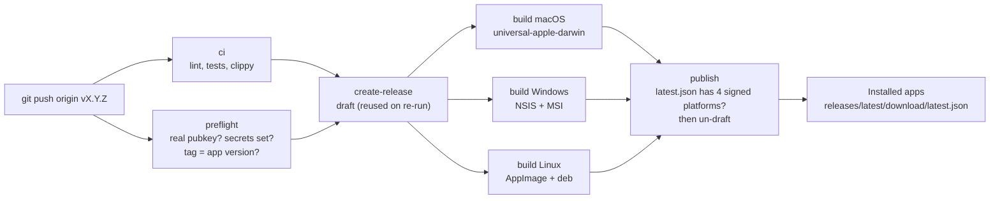

# Releasing VisTracer

Releases are built, signed and published by `.github/workflows/release.yml`
when a `v*` tag is pushed. The Tauri updater in installed apps reads
`latest.json` from the newest published release.



## One-time setup: the update signing key

Do this once, before the first release that should support in-app updates.
Never commit the private key and never paste it into an issue, PR or log.

1. Generate the key pair. Set a password when asked.

   ```bash
   npx tauri signer generate -w ~/.tauri/vistracer.key
   ```

   This writes `~/.tauri/vistracer.key` (private) and
   `~/.tauri/vistracer.key.pub` (public). Keep a backup of the private key and
   its password in a password manager. If the key is lost, installed apps
   cannot verify later updates and users must reinstall by hand.

2. Put the public key into the app. Replace the value of
   `plugins.updater.pubkey` in `src-tauri/tauri.conf.json` (the text that
   starts with `PUBLIC KEY PLACEHOLDER`) with the full contents of
   `~/.tauri/vistracer.key.pub`. Commit this through a pull request.

3. Add the repository secrets:

   ```bash
   gh secret set TAURI_SIGNING_PRIVATE_KEY -R rush-skills/vistracer < ~/.tauri/vistracer.key
   gh secret set TAURI_SIGNING_PRIVATE_KEY_PASSWORD -R rush-skills/vistracer
   ```

   The second command prompts for the password.

The release workflow refuses to run while the public key is the placeholder
or `TAURI_SIGNING_PRIVATE_KEY` is not set.

## Each release

1. Set the same version in `package.json`, `src-tauri/Cargo.toml`,
   `src-tauri/tauri.conf.json` and `website/src/pages/index.astro`
   (`const version`). The preflight job fails if the tag and
   `tauri.conf.json` disagree.
2. Move the `[Unreleased]` notes in `CHANGELOG.md` under the new version.
3. Merge to `main`, then tag and push:

   ```bash
   git tag -a v1.1.0 -m "v1.1.0"
   git push origin v1.1.0
   ```

4. Watch the workflow. The `publish` job un-drafts the release only when
   `latest.json` has a signed entry for `darwin-aarch64`, `darwin-x86_64`,
   `linux-x86_64` and `windows-x86_64`. If it reports a missing platform
   (two build jobs finished at the same time and one entry was overwritten),
   re-run that build job and then the `publish` job.

Notes:

- The macOS DMG is universal (Apple Silicon and Intel):
  `VisTracer_<version>_universal.dmg`. The website switches its macOS link
  to this name when `version` is no longer `1.0.0`.
- Apps installed from v1.0.0 have no updater. Users get the first
  updater-enabled release by downloading it; later releases update in-app.
- Every action in `.github/workflows/` is pinned to a full commit SHA, with
  its version in a comment (`@<sha> # v6.1.0`). A moved tag cannot change
  what the release job (which has `contents: write` and the signing key)
  runs. Dependabot (`github-actions`, weekly) opens the bumps; keep the
  SHA form when you edit a workflow.
- CI builds (`ci.yml`) and local `npm run tauri:build` do not create updater
  artifacts, so they need no key. To build a signed release locally:

  ```bash
  export TAURI_SIGNING_PRIVATE_KEY="$(cat ~/.tauri/vistracer.key)"
  export TAURI_SIGNING_PRIVATE_KEY_PASSWORD="..."
  npm run tauri build -- --config src-tauri/tauri.updater.conf.json
  ```
